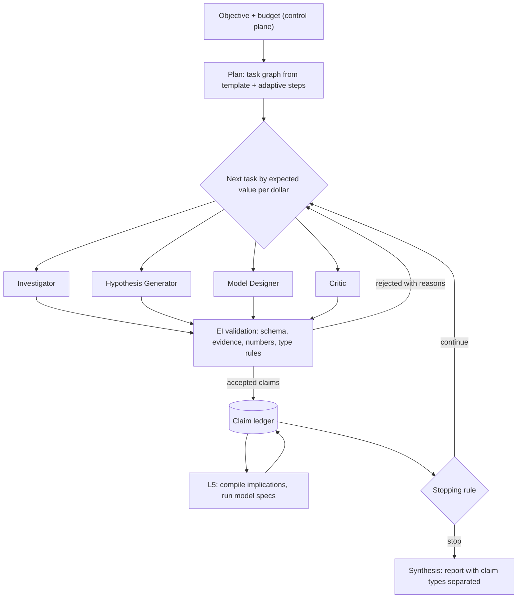

# AI Agent System (Master Architecture v1.0, layer L4)

Related documents:
- [MASTER_ARCHITECTURE.md](MASTER_ARCHITECTURE.md#l4-autonomous-ai-workforce) (layer contract)
- [CAPABILITY_MATRIX.md](CAPABILITY_MATRIX.md#l4-autonomous-ai-workforce) (what exists)
- [WORLD_MODEL.md](WORLD_MODEL.md) (what agents read)
- [SIMULATION_AND_LEARNING.md](SIMULATION_AND_LEARNING.md) (what happens to agent output)
- [ADR-004](ARCHITECTURE_DECISIONS.md#adr-004), [ADR-009](ARCHITECTURE_DECISIONS.md#adr-009)

Status: **proposed design**. Today's agents (`src/halibut/agents/orchestrator.py`) run a fixed
Research → Hypothesis → Critic pipeline whose Hypothesis agent only selects among predictions
the engine has already built (`docs/benchmark_haiku_v1_diagnostic.md`, F1).

## 1. What changes and why

| Today | v1.0 |
|---|---|
| The agent chooses `kind` ∈ {momentum, displacement, exposure} and a `subject`; the engine builds the prediction | The agent writes an **original hypothesis**: a mechanism, conditions, assumptions, alternatives and **observable implications**. A deterministic compiler turns the implications into resolvable tests, and the agent may also propose a **model spec** that L5 registers and runs |
| Fixed pipeline | The orchestrator plans an investigation as a task graph with budgets and stopping rules |
| Prompt-instructed JSON | **Schema-enforced structured outputs**; malformed output is rejected, never repaired |
| One bundle shape per role | Token-budgeted world slices from the Context Assembly service |
| Agents evaluated on the same predictions as the reference | Evaluated on hypothesis survival, information gain, novelty, forecast skill of the models they propose, and cost per useful validated result |

The principle that is kept is **agents propose; deterministic components compute, validate and
store** (principle B). The agent's freedom moves from "which predefined prediction" to "which
question, which mechanism, which test, which model".

## 2. Roles

### 2.1 MVP workforce (R2)

| Agent | Responsibility | Inputs | Outputs (claim types) | Default model class |
|---|---|---|---|---|
| **Orchestrator** (Investigation Lead) | Turns an objective into a task graph; allocates budget; decides continue or stop; synthesises | Objective, budget, slice index, track record | Investigation plan, synthesis report | Small model plus deterministic planner template |
| **Investigator** | Finds anomalies, gaps and questions in the evidence; requests offline tools; proposes new sources (pending approval) | Slices, anomaly scans (deterministic) | **Explanations**, questions, research requests | Small |
| **Hypothesis Generator** | Writes original falsifiable hypotheses with mechanisms, assumptions, alternatives, implications and refutation criteria | Explanations, slices, reference hypothesis library, lessons | **Hypotheses** | Small first; larger model as a benchmarked option |
| **Model Designer** | Translates a hypothesis into a model spec (family, variables, structure, priors, evaluation protocol) | Hypothesis, model-registry catalogue, data availability | **Model specs** (to L5) | Small or medium |
| **Critic** (red team) | Attacks each hypothesis and model spec: confounders, denominators, mix effects, leakage, alternatives; proposes discriminating tests | Hypotheses, specs, evidence | **Critiques**, alternative hypotheses, discriminating tests | A different model or prompt from the generator, to reduce correlated errors |

The **deterministic reference workforce** (`intel/agents.py`) stays in place as the baseline
every LLM workforce must beat.

### 2.2 Growth specialists

| Agent | Adds |
|---|---|
| Competitive Analyst | Competitor positioning, portfolio overlap, response history |
| Causal Reasoner | Causal graphs, identification strategy, natural experiments, instrument proposals |
| Strategy Analyst | Lawful options under the three modes; expected effects via simulation |
| Simulation Designer | Scenario trees, intervention schedules, competitor-response rules for L5 |
| Experiment Designer | Pre-registered protocols, power analysis, guardrails, measurement plans |
| Financial Analyst | Filings, margins, capacity and capital constraints |
| Regulatory Analyst | Applicable regulations, compliance checklists (feeds the L7 gate; never the final legal word) |
| Narrative Analyst | Cultural and media narratives from licensed text; salience series |
| Evidence Extractor | Assertions from documents with spans and calibrated confidence |

### 2.3 Full-scale workforce
- persistent market "desks" per industry and region;
- delegation trees: a group-level lead and country sub-investigations;
- self-scheduled re-investigation when new evidence or scores arrive, within standing budgets;
- workforce composition chosen by L6 evaluation.

## 3. The orchestrator



**Planning.** The MVP uses a template:
1. scan;
2. explain;
3. hypothesise;
4. design;
5. critique;
6. revise once;
7. compile and test;
8. synthesise.

The template is adaptive within those steps: the orchestrator chooses which hypotheses get
model specs, based on the critic's severity and on expected information gain. At Growth, the
orchestrator chooses steps itself from a task library, under the same budget and stopping
rules.

**Delegation.** A task is a `TaskSpec`:
- id;
- role;
- objective;
- slice request;
- allowed tools;
- output schema id;
- budget (tokens, dollars, wall time);
- parent task;
- deadline.

Sub-orchestrators (Growth) receive a budget slice and must return a typed result. No agent can
raise its own budget.

## 4. Structured communication

Every agent call uses a registered output schema
([ADR-009](ARCHITECTURE_DECISIONS.md#adr-009)), enforced at generation through provider
structured outputs where they are available and validated again by EI. Ids, enums and lengths
come **from the slice** (the allowed metric ids, subjects and kinds), which removes the F2 and
F3 failure modes structurally.

**Hypothesis schema (v1, abridged)**

```json
{
  "hypothesis_id": "assigned by EI",
  "statement": "one sentence, mechanism-level",
  "mechanism": {"cause": "entity/variable id", "effect": "metric id", "pathway": "text", "direction": "+|-"},
  "conditions": ["scope conditions: market ids, periods, segments"],
  "assumptions": [{"text": "...", "type": "assumption"}],
  "supporting_evidence": [{"id": "metric:… | obs:… | doc:…#span", "role": "supports|context"}],
  "alternative_explanations": [{"statement": "...", "discriminating_test": "implication id"}],
  "observable_implications": [{
      "id": "imp-1",
      "quantity": {"metric_template": "segment_share", "entity": "brand:byd", "market": "market:uk_cars", "periods": "next 2 quarters"},
      "prediction": {"direction": "above", "reference": "metric:segment_share:L4:byd"},
      "would_refute_if": "realised share <= reference"}],
  "refutation_criteria": "text plus the implication ids that would refute it",
  "novelty_claim": "what this adds beyond the reference library",
  "confidence": "low|medium|high",
  "model_spec_request": "optional: a model family or variable to add"
}
```

The `quantity` uses a **closed grammar** of metric templates (share, share difference, growth,
price index, …) defined in the semantic metrics catalogue (L3). The agent composes new
*combinations* (entity, market, segment, period, condition); the compiler checks that each is
computable and resolvable. **Originality lives in the mechanism and the choice of implications,
not in inventing metrics.**

## 5. Original hypothesis discovery

This is the process the Hypothesis Generator and Critic follow. It is designed to produce
propositions that the reference workforce would not.

1. **Anomaly scan (deterministic).** Residuals of baseline models, breaks, divergences between
   related series, unusual decompositions (within-segment vs mix), events near breaks.
   Anomalies give candidate questions without biasing toward templates.
2. **Explanations (Investigator).** Each anomaly gets candidate explanations, checked for
   fidelity: is the claim supported by the cited evidence and no more?
3. **Mechanism hypotheses (Generator).** For each well-supported explanation, the Generator
   proposes a mechanism. It must state:
   - at least one **alternative**;
   - at least one implication that **discriminates** between them;
   - at least one implication **outside the data that inspired it**: another segment,
     geography or period, or a future window.
4. **Novelty check (deterministic plus Critic).** The hypothesis is compared against the
   reference hypothesis library (everything the deterministic workforce and earlier
   investigations already produced) by its implication signature (metric template × entity ×
   market × direction × horizon). Duplicates are flagged as *restatements* and do not count as
   original.
5. **Critique and revision.** The Critic attacks it; the Generator may revise once; any
   disagreement that remains is preserved.
6. **Compilation (L5).** Implications become registered resolvable tests (prediction spec v2
   or later), and optional model specs become registered model versions. Both are
   **frozen before outcomes are visible** (pre-registration).

## 6. Memory and context

| Memory | Scope | Store | Rules |
|---|---|---|---|
| Working memory | One task | Task record | Discarded after the task; the summary is kept |
| Investigation memory | One investigation | Plan, claims and critiques in the ledger | Visible to all agents in the investigation |
| Shared validated knowledge | All investigations (tenant-filtered) | EI ledger + `knowledge` (lessons) | Only **validated** lessons enter contexts by default; proposed ones only if marked as such |
| Track record | Per agent, model and prompt version | L6 scores | Read-only for agents; used for routing |
| Reference library | Per market | Prior hypotheses' implication signatures | Novelty checks |

**Context assembly.** Agents receive slices ([WORLD_MODEL.md §8](WORLD_MODEL.md#8-scale-a-multinational-with-thousands-of-products)) with:
- compact tables;
- allowed id lists for the output schema;
- quoted document spans marked `UNTRUSTED_SOURCE_TEXT`;
- the relevant claims, labelled with their types.

Context size is budgeted per task class.

## 7. Evidence handling and prompt-injection hygiene

- Agents cite ids only. Numbers in text must match evidence values (the existing
  `validation.check_numbers`).
- Document text is passed as quoted spans with ids. Agent system prompts state that quoted text
  is data. Schemas leave no field where an instruction found in text could trigger an action.
- Tools are tiered:

  | Tier | What it allows | When |
  |---|---|---|
  | 0 | Read slices and compute metrics | Always |
  | 1 | Offline store tools | Always |
  | 2 | Network fetch from catalogued sources within budget | Per investigation approval |
  | 3 | New sources, paid data, anything outbound | Per-action founder approval |

  Today's `OFFLINE_TOOLS` and `PROPOSABLE_TOOLS` become tiers 1 and 2–3.

## 8. Disagreement, critique and resolution

- Critiques are claims linked to their targets with a severity. They are **never merged or
  softened** (the existing `CRITIC_SYSTEM` rule).
- When the generator and critic disagree, the system **designs a discriminating test**. It does
  not take a vote. Unresolved disagreements are reported side by side with the test that would
  settle them.
- Independence: the critic uses a different prompt and, where budget allows, a different model.
  L6 measures how often critiques anticipate refutations (critic skill).

## 9. Stopping conditions

An investigation stops at the **first** of:
1. budget exhausted (tokens, dollars or wall time, enforced by L1);
2. the target number of validated, non-duplicate hypotheses reached;
3. diminishing returns: the last *k* tasks added no accepted claim, or expected information
   gain per dollar fell below a threshold;
4. maximum depth of revise and critique cycles (default 1);
5. a blocking approval (tier-3 tool, paid escalation);
6. repeated schema failures: more than *n* rejections for the same task class trips a circuit
   breaker and reports.

## 10. Model routing and cost

| Task class | MVP model | Escalation (benchmarked, approval-gated) |
|---|---|---|
| Orchestration, investigation, extraction | Claude Haiku 5.5 | — |
| Hypothesis generation | Haiku 5.5 | Sonnet 5.5, if the L6 benchmark shows better hypothesis survival per dollar |
| Critique | Haiku 5.5 with a different prompt | Sonnet 5.5 for high-stakes options |
| Model design | Haiku 5.5 | Sonnet 5.5 |

Routing decisions are promotions: a routing table version changes only after an L6 evaluation
and founder approval. The Qwen provider remains a configured alternative.

## 11. Capability progression

| Capability | MVP (R2–R3) | Intermediate (Growth) | Full scale |
|---|---|---|---|
| Investigation planning | Template + adaptive selection | Task-library planning; parallel sub-investigations | Persistent desks; self-scheduled re-investigation |
| Hypotheses | Original mechanism hypotheses with compiled implications in one market | Cross-market implications; causal identification proposals | Portfolio-level theory building across industries |
| Models | Model specs within registered families | New structural terms and hierarchical variants | Multiscale coupled model proposals |
| Strategy | — (L7 MVP uses deterministic option templates) | Strategy Analyst with simulation | Continuous strategy programmes |
| Evidence | Offline store + catalogued sources | Document extraction with spans | Multi-jurisdiction, multilingual extraction |
| Collaboration | Generator and Critic, one revision | Specialist delegation, adjudication by tests | Delegation trees with budget markets |
| Evaluation | Benchmarked per role and version | A/B on fixed evidence, critic skill | Continuous evaluation and routing |
| Autonomy | Investigates within one approved budget | Standing budgets per market | Standing budgets with portfolio limits; **external actions always human** |

## 12. Requirements carried from the benchmark diagnosis

| Finding | Requirement |
|---|---|
| F1 selection only | Hypotheses are original propositions with compiled implications; restatements are detected and do not count |
| F2 evidence format | Schema enforcement with id enums from the slice; rejection reasons typed |
| F3 subject mismatch | Subject enums from the slice; drops are counted |
| F4 truncation | Bounded outputs (`maxItems`, length limits); the text of failed replies is stored |
| F5 conditional critic | Plans report expected and actual calls by role |
| F6 underpowered comparison | Matched and selection-aware evaluation (L6) |
| F7 leakage | Context carries availability bases; LLM-cutoff tagging on evaluations |
