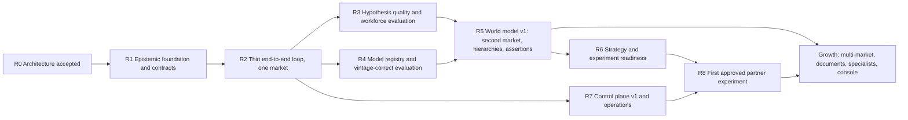

# Implementation Roadmap (Master Architecture v1.0)

Related documents:
- [MASTER_ARCHITECTURE.md](MASTER_ARCHITECTURE.md)
- [CAPABILITY_MATRIX.md](CAPABILITY_MATRIX.md) (starting point)
- [ARCHITECTURE_DECISIONS.md](ARCHITECTURE_DECISIONS.md) (decisions each milestone depends on)

Status: v1.0 accepted (founder, 2026-11-23). **R1 is implemented**
([R1_IMPLEMENTATION.md](R1_IMPLEMENTATION.md)); **R2 and later are not authorised**. No milestone
starts without founder approval. There are no calendar deadlines; milestones are ordered by
dependency.

## 1. Principles

1. **Thin end to end first.** Every layer gets a lightweight working version early (R2), and
   later milestones deepen it. Foundations (contracts, claim ledger, schemas) come before
   features.
2. **Intelligence quality is measured, not asserted.** Every milestone that changes agents or
   models ends with an offline evaluation. Paid benchmarks run only with approval, and only
   when a power check says the result can be informative.
3. **Low operating cost by default.** Haiku-class models, caching, selective invocation, local
   compute, SQLite until the [ADR-011](ARCHITECTURE_DECISIONS.md#adr-011) triggers fire.
4. **No infrastructure ahead of need** (principle I).

## 2. Dependency graph

## 3. Milestones

### R0 Architecture accepted
- **Deliverable:** this document set, reviewed.
- **Acceptance:** the founder approves or amends the ADRs (status changes from *Proposed* to
  *Accepted*) and the founder decisions in §5 are answered.
- **Cost:** $0.

### R1 Epistemic foundation and contracts (offline)

> **Status: implemented 2026-11-23.** Acceptance met. The offline reconstruction reproduced the
> Haiku benchmark exactly (10 valid / 17 rejected / 9 dropped / 13 truncated / 10 raw → 8 unique
> predictions). The reference replay is unchanged, and 259 tests pass. Delivered beyond the
> original R1 list: the cross-industry market coverage contract (ADR-014). Still open from the
> R1 list: the task-class routing table (moved to R2), the selection-vs-random comparison, and an
> import-lint test for the layer dependency rules. See
> [R1_IMPLEMENTATION.md §5](R1_IMPLEMENTATION.md#5-known-limits-of-r1-honest-list).
- **Scope:**
  - the EI claim ledger (typed claims: explanation, hypothesis, forecast, simulated outcome,
    critique, lesson; links; validation results), built on the existing tables without
    breaking them;
  - an append-only event log with hash chain;
  - a schema registry with JSON schemas for every agent task;
  - structured-output support in the LLM gateway (Anthropic `output_config.format`), with
    prompt-JSON kept only for providers without it;
  - storage of failed-reply text;
  - **the deferred benchmark fixes** (`docs/benchmark_haiku_v1_diagnostic.md` §Proposed
    fixes 1–7): a failure taxonomy, counting of drops before validation, duplicate-prediction
    removal, the exposure subject label, per-origin rejection reasons, conditional-critic
    reporting, and matched and selection-aware comparison;
  - a task-class routing table (one entry per role, Haiku by default).
- **Acceptance:**
  - replaying the stored Haiku benchmark offline from cache gives a corrected classification
    (17 format errors, 9 counted drops, 8 unique predictions);
  - claim-type mixing is rejected by tests;
  - all existing tests pass;
  - schemas are versioned.
- **Tests:**
  - ledger type rules;
  - event-chain integrity;
  - schema validation fixtures, including every F2 and F3 malformed form;
  - an offline benchmark reconstruction test.
- **Risks:**
  - over-generalising the ledger, which is mitigated by migrating `hypotheses`, `knowledge`
    and `prediction_scores` behind views first;
  - SDK structured-output limits, mitigated by EI validating every reply anyway.
- **Cost:** $0 (offline).

### R2 Thin end-to-end loop, one market (UK cars)
- **Scope**, one lightweight increment per layer:

  | Layer | Increment |
  |---|---|
  | L1 | Routing table, durable workflow record for investigations (resumable steps) |
  | L2 | No new sources; publication-calendar dating for DfT where available |
  | L3 | Context Assembly v0 (slices with id enums); market definition persisted |
  | L4 | Orchestrator with the template plan; Investigator, Hypothesis Generator, Model Designer, Critic with schemas; the original-hypothesis process ([AGENT_SYSTEM.md §5](AGENT_SYSTEM.md#5-original-hypothesis-discovery)) |
  | L5 | Implication compiler; model-spec validation; registry wrapper over the existing families |
  | L6 | Hypothesis tests and statuses; cost per useful validated result v1 ([SIMULATION_AND_LEARNING.md §9](SIMULATION_AND_LEARNING.md#9-cost-per-useful-validated-result)) |
  | L7 | Deterministic option templates from survived hypotheses + ABM scenario comparison (labelled synthetic) + compliance checklist + an experiment protocol **draft** |
  | L8 | Approvals table and `halibut approve`; budget registry; report sections labelled by claim type |
  | EI | Temporal guard extended with LLM-cutoff tags |

- **Acceptance:**
  1. One command runs Objective → … → protocol draft → (replay) outcome scoring → proposed
     lessons offline with the mock workforce, deterministically.
  2. With the reference workforce, results are reproducible bit for bit.
  3. One approved Haiku run produces ≥1 hypothesis whose implication signature is **not** in
     the reference library and which compiles into resolvable tests. That proves agents can
     originate; it does not yet prove quality.
- **Tests:**
  - end-to-end offline test on fixtures;
  - compiler rejects hindsight and non-computable implications;
  - restatement detection;
  - compliance gate blocks a prohibited lever;
  - approvals required for paid steps.
- **Cost:** one approved Haiku investigation over 10 origins. Estimate: about 50 calls × ~6k
  input and ~1.5k output tokens ≈ **$0.07**, worst case below $0.15. A smoke run first.
- **Risks:**
  - agents produce plausible but untestable hypotheses, mitigated by the compiler gate and
    G5;
  - the scope is large, mitigated by keeping each layer increment minimal.

### R3 Hypothesis quality and workforce evaluation
- **Scope:**
  - an evaluation protocol for original hypotheses: survival, refutation, information gain,
    novelty and critic skill, split into pre-cutoff and post-cutoff windows;
  - a power check before paid runs;
  - comparisons on identical evidence of:
    - the reference workforce;
    - Haiku;
    - (if approved) Sonnet for the Generator and Critic only.
- **Acceptance:**
  - the report states with intervals whether any LLM workforce produces more useful validated
    results per dollar than the reference;
  - "inconclusive" is an acceptable, honest outcome;
  - no promotion without approval.
- **Cost:**
  - Haiku, about $0.07–0.15 per replay;
  - Sonnet, about 20× Haiku per token: roughly $1–1.5 per 10-origin replay, so it needs fewer
    origins or a per-run cap above $1 (a **founder decision**).
- **Risks:** too few post-cutoff outcomes for power. The mitigation is honest
  "inconclusive", plus more markets in R5.

### R4 Model registry and vintage-correct evaluation
- **Scope:**
  - the full registry (spec, calibration, data vintages, status);
  - hypothesis-derived model variants evaluated rolling-origin against baselines;
  - vintage-preserving ingestion (re-ingest keeps revisions; outcomes resolved on the
    registered vintage);
  - interval-calibration reports.
- **Acceptance:**
  - every forecast claim names a registered model version;
  - a model derived from a hypothesis is evaluated against mandatory baselines with the
    existing rule;
  - vintage selection is covered by tests.
- **Cost:** $0 (compute only).
- **Risks:** historical vintages are not available from publishers. Mitigation: record forward
  from now; label history as "latest vintage".

### R5 World model v1: second market, hierarchies, assertions
- **Scope:**
  - the ontology additions ([WORLD_MODEL.md §10](WORLD_MODEL.md#10-mapping-from-the-current-schema));
  - assertions with confidence and contradiction detection;
  - product, geography and organisation hierarchies;
  - a tenant column;
  - a second market using data already ingested (Norway BEV, SSB), so cross-market
    implications can be tested;
  - Context Assembly v1 with hierarchy levels.
- **Acceptance:**
  - a cross-market hypothesis (formed in the UK, tested in Norway or the reverse) runs end to
    end;
  - contradictions are preserved and resolved per question;
  - tenant filtering has tests.
- **Cost:** about $0.2–0.5 of approved LLM use for cross-market runs.
- **Risks:** universes are not comparable across countries, so the metric catalogue must block
  invalid comparisons.

### R6 Strategy and experiment readiness (no execution)
- **Scope:**
  - Strategy Analyst agent;
  - competitor-response rules in L5;
  - options with simulated effect ranges;
  - jurisdiction checklists (UK and Norway first);
  - full experiment protocols with power analysis;
  - an outcome-measurement contract.
- **Acceptance:**
  - options trace to survived hypotheses;
  - every option passes or fails the compliance gate with reasons;
  - protocols are complete and pre-registrable.
- **Cost:** small LLM use (≤ $0.5 approved).
- **Risks:** options look actionable without real validation. Mitigation: label simulated
  effects and require legal review for consequential options.

### R7 Control plane v1 and operations (can start after R2, in parallel)
- **Scope:**
  - a unified approvals, budget and audit view (CLI first, then a read-only local web
    console if the founder approves);
  - a scheduler for refresh and `score_due`;
  - Postgres-readiness tests (the same migrations on Postgres);
  - observability (structured logs and cost metrics).
- **Acceptance:**
  - every paid or consequential action has an approval record;
  - the audit chain verifies;
  - migrations pass on SQLite and Postgres.
- **Cost:** $0, unless hosting is chosen (founder decision).

### R8 First approved partner experiment
- **Prerequisites:**
  - a partner or client with an operating business;
  - a legal basis;
  - a measurement data agreement.
- **Scope:** one pre-registered experiment, executed by the partner, and measured and
  evaluated by Halibut.
- **Acceptance:** the effect estimate is compared with the simulated expectation, and the
  learning is recorded with status per the rule.
- **Cost:** partner-dependent; a founder decision.

## 4. Layer maturity: reuse vs build

| Layer | MVP (through R2) | Growth (R3–R7 and after) | Full scale | Reused from repo | Genuinely new |
|---|---|---|---|---|---|
| L1 | Routing table, schemas in gateway, durable investigation record, failed-reply text | Postgres, job queue, scheduler, telemetry, provider fallback | Distributed execution, per-tenant quotas | `agents/llm.py`, `agents/anthropic_provider.py`, `agents/budget.py`, `batch.py`, `data/http.py` | Routing, workflow state, structured-output support |
| L2 | Existing connectors + calendar dating | Filings, regulation, licensed news text, refresh, proposed sources | Hundreds of sources, client connectors | `data/catalogue.py`, `data/ssb.py`, `providers/*`, `data/quality.py`, `data/events.py` | Vintage-preserving re-ingest, document connectors |
| L3 | Slices v0, persisted market definition | Ontology, assertions, hierarchies, tenancy | Partitioned multi-industry knowledge base | `data/store.py`, `intel/retrieval.py`, `intel/signals.py`, `data/providers/wikidata.py`, `intel/market.py` | Assertions, hierarchies, context service |
| L4 | Orchestrator + 4 agents with schemas; original hypotheses | Specialists, delegation, A/B | Persistent desks | `agents/orchestrator.py`, `agents/mock.py`, `intel/agents.py`, `interfaces.py` | Planner, Generator process, Model Designer, schemas |
| L5 | Registry wrapper, compiler, spec validation | Hierarchical and structural models, competitor response, ensembles | Multiscale coupled models | `engine.py` and related modules, `empirical/*`, `calibration.py`, `sensitivity.py`, `suite.py`, `intel/forecast.py` | Registry, compiler, response models |
| L6 | Hypothesis tests, matched evaluation, cost per useful validated result v1, cutoff tags | Vintage-correct, multi-market, critic skill | Continuous evaluation | `learning/predictions.py`, `learning/evaluate.py`, `learning/memory.py`, `learning/lineage.py`, `intel/replay.py`, `intel/benchmark.py` | Hypothesis test lifecycle, selection tests |
| L7 | Option templates, compliance checklist, protocol drafts | Strategy agent, competitor scenarios, partner experiments | Programmes | `validation.py` levers and prohibitions, `interventions.py`, `intel/market.py` | Options, compliance gate, protocols |
| L8 | Approvals table, budget registry, audit chain, labelled reports | Read-only console, roles | Multi-user control plane | Config approval flags, `--yes`, `--max-usd`, `promote --approved-by` | Approvals, audit chain, console |
| EI | Ledger, schemas, failure taxonomy, cutoff tags | Fidelity audits, contradiction workflows | Exportable provenance | `validation.py`, `intel/audit.py`, `intel/signals.py`, `learning/memory.py` | Unified ledger, schema registry |

## 5. Decisions requiring founder approval

| # | Decision | Needed by | Options / recommendation |
|---|---|---|---|
| D1 | Accept the revised layers (EI plane, L3 and L5 renames, L8 split) | R0 | Recommend accept |
| D2 | Agents propose model specs; registered models compute forecast numbers ([ADR-004](ARCHITECTURE_DECISIONS.md#adr-004)) | R0 | Recommend accept |
| D3 | Structured outputs mandatory; malformed output rejected, never repaired ([ADR-009](ARCHITECTURE_DECISIONS.md#adr-009)) | R1 | Recommend accept |
| D4 | Paid budget for R2 (≈ $0.07–0.15) and R3 (Haiku ≈ $0.15; Sonnet ≈ $1–1.5, needing a per-run cap change or fewer origins) | R2, R3 | Approve R2; decide on Sonnet after R2 |
| D5 | Second market choice for R5 (recommend Norway BEV, already ingested) | R5 | Norway BEV, or another public dataset |
| D6 | Tenancy model before any client data ([ADR-013](ARCHITECTURE_DECISIONS.md#adr-013)) | R5 | Recommend a tenant column now, row-level security at Postgres |
| D7 | Web console (and hosting) vs CLI-only through R7 ([ADR-010](ARCHITECTURE_DECISIONS.md#adr-010)) | R7 | Recommend a local read-only console after R2 is stable |
| D8 | Commercial or paid data sources (filings, news text, panels) | Growth | Case by case, with licence review |
| D9 | Real-world experiment partner, legal review arrangement | R8 | Required before any experiment |
| D10 | Postgres or hosted database migration ([ADR-011](ARCHITECTURE_DECISIONS.md#adr-011) triggers) | R7 or later | When a trigger fires |

## 6. Risk register

| Risk | Impact | Mitigation |
|---|---|---|
| LLM hypotheses are plausible but rarely survive | Low value per dollar | The compiler gate, Critic, honest refutation metrics; the reference workforce as a floor |
| Too few post-cutoff outcomes for statistical power | Inconclusive evaluations | More markets (R5), power checks before paid runs, accept "inconclusive" |
| ABM keeps losing to simple models | Simulation adds cost without accuracy | Mandatory baselines; ABM only for mechanism and scenario questions; hierarchical statistical models for forecasts |
| Scope creep from the full-scale vision | Nothing reaches end to end | R2 thin loop first; every milestone has acceptance tests |
| Data licensing constraints (ODbL, commercial terms) | Cannot deliver to clients | Licence fields enforced at export |
| Prompt injection once document text arrives | Compromised agent behaviour | EI quoted-span rule and tool tiers **before** document connectors (R5+) |
| Cross-tenant leakage | Severe | Tenancy in R5, before any client data |
| Strategy misuse (unlawful displacement) | Legal and ethical harm | Compliance gate, human legal review, prohibited-tactics backstop, no external actions by Halibut |
| SQLite contention at scale | Reliability | ADR-011 triggers; Postgres-readiness in R7 |
