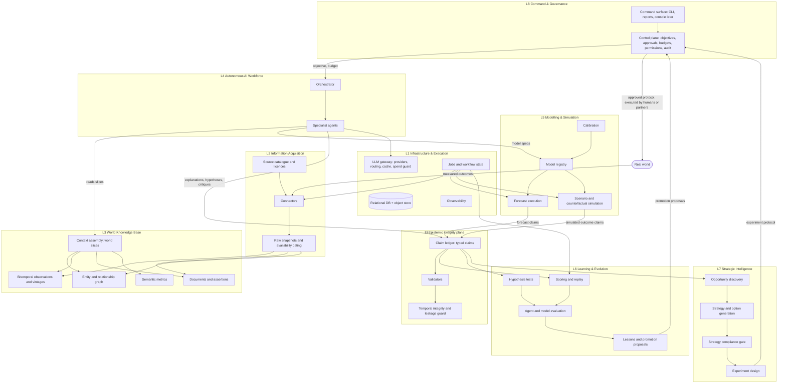
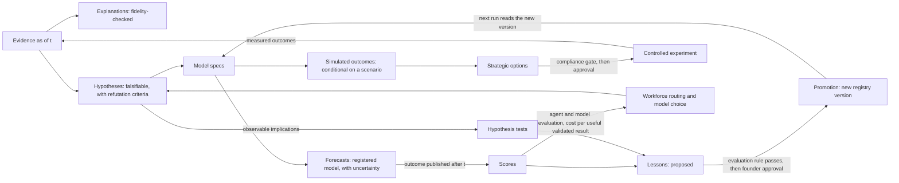
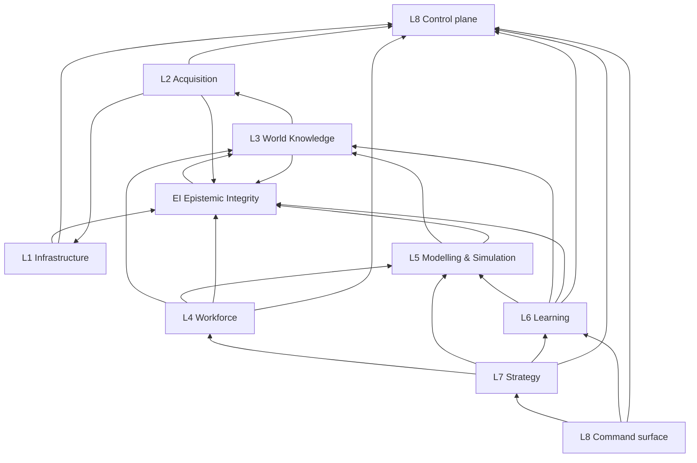

# Halibut AI: Master Architecture v1.0

| | |
|---|---|
| Version | 1.0 (2026-11-23) |
| Status | **Accepted as the baseline architecture by the founder on 2026-11-23, with qualifications** ([ARCHITECTURE_DECISIONS.md §6.0](ARCHITECTURE_DECISIONS.md#60-founder-decisions-of-2026-11-23-approval-of-v10-with-qualifications)). R1 and R2 are implemented ([R1_IMPLEMENTATION.md](R1_IMPLEMENTATION.md), [R2_IMPLEMENTATION.md](R2_IMPLEMENTATION.md)); R2 is tested offline only. Nothing else here is implemented unless [CAPABILITY_MATRIX.md](CAPABILITY_MATRIX.md) says so. |
| Supersedes | The per-phase component lists in `docs/phase4_intelligence.md` §1 and `docs/phase5_agents_learning.md` §1 |
| Governance | [ARCHITECTURE_DECISIONS.md](ARCHITECTURE_DECISIONS.md) |

**Document map**

| Document | Answers |
|---|---|
| MASTER_ARCHITECTURE.md (this) | What the layers are, how they connect, and the critique of the proposed design |
| [CAPABILITY_MATRIX.md](CAPABILITY_MATRIX.md) | What exists today, layer by layer, with file paths |
| [WORLD_MODEL.md](WORLD_MODEL.md) | The canonical ontology: identity, time, uncertainty, provenance, contradictions, scale |
| [AGENT_SYSTEM.md](AGENT_SYSTEM.md) | Orchestrator, agents, tools, structured outputs, memory, disagreement, stopping, maturity |
| [SIMULATION_AND_LEARNING.md](SIMULATION_AND_LEARNING.md) | Hypotheses → model specs → forecasts and simulations → evaluation → validated learning |
| [STRATEGIC_OPERATING_LOOP.md](STRATEGIC_OPERATING_LOOP.md) | Objective → … → validated learning, with outputs and quality gates |
| [IMPLEMENTATION_ROADMAP.md](IMPLEMENTATION_ROADMAP.md) | Dependency-ordered milestones, acceptance criteria, costs, founder decisions |
| [ARCHITECTURE_DECISIONS.md](ARCHITECTURE_DECISIONS.md) | Versioning, ADRs, ownership, contracts, change rules |
| [R1_IMPLEMENTATION.md](R1_IMPLEMENTATION.md) | What R1 built, how it behaves, acceptance results and known limits |
| [R2_IMPLEMENTATION.md](R2_IMPLEMENTATION.md) | The first complete intelligence loop: what works, examples, limits |
| [INVESTIGATION_RESULT_CONTRACT.md](INVESTIGATION_RESULT_CONTRACT.md) | The result document, statuses and read-only API for frontends |
| [R2_LIVE_VALIDATION_PLAN.md](R2_LIVE_VALIDATION_PLAN.md) | The pre-registered first live R2 experiment: design, cost, criteria, leakage |
| [R2_POSTMORTEM_r2v-b16fc9281536.md](R2_POSTMORTEM_r2v-b16fc9281536.md) | Root cause and reasoning assessment of the first live R2 run |
| [R2_STEP1_REVALIDATION_PLAN.md](R2_STEP1_REVALIDATION_PLAN.md) | Mixed cached/live engineering revalidation (approved, not yet run) |
| [R2_STEP2_PROPOSAL.md](R2_STEP2_PROPOSAL.md) | Proposal: competing mechanisms, discriminating predictions, held-out comparisons |

---

## 1. Purpose, scope and non-goals

Halibut AI is an AI-first platform for market intelligence, world simulation, strategic
market engineering and continuous learning. It investigates why markets change, proposes and
tests original explanations, simulates possible futures, develops **lawful** strategies, and
learns from measured outcomes. Over time it must reason about multinational companies, entire
industries and connected geographic markets.

**Non-goals.** Halibut is not:
- a marketing dashboard;
- a chatbot;
- a forecasting spreadsheet;
- a social-media automation tool.

It does not use deceptive engagement, fabricated evidence, covert influence, impersonation or
unauthorised outreach, and it takes no consequential external action without founder approval
(principle H).

**Long-term requirement vs. current feasibility.** This document describes the full system.
Each layer section says what is **long-term** and what the **MVP** is. The capability matrix
records what is real today. Speculative capabilities are never described as implemented.

## 2. Critique of the proposed eight layers

The eight layers are a sound *functional* decomposition. Several problems, however, would hurt
quality, safety or scale if they were adopted as written.

| # | Finding | Why it matters | Recommendation |
|---|---|---|---|
| C1 | **There is no home for epistemic integrity.** Separating explanations, hypotheses and forecasts (A), labelling claim types (C) and preventing leakage (G) are cross-cutting. As drafted, validation would sit inside the agent layer (agents validating themselves) or inside learning (learning validating its own lessons). | A conflict of interest, and the root cause of the benchmark failure mode (F1 in `docs/benchmark_haiku_v1_diagnostic.md`): the line between "agent output" and "engine number" was never made explicit. | Add a cross-cutting **Epistemic Integrity plane (EI)**: the claim ledger with typed claims, deterministic validators, provenance, the temporal integrity guard, and the agent-output contract. Every layer writes claims through it; no layer validates its own output. |
| C2 | **Layer 5 is "World Simulation" only.** Most numerical forecasts in practice come from statistical, econometric and diffusion models, not agent-based simulation. Phase 3 showed logistic and Bass curves beating the calibrated ABM (MAE 5.38 / 5.45 pp vs 7.42 pp; `docs/phase3_results.md`). | A simulation-only layer would push every forecast through the most expensive and least accurate model family, and leaves no place for a model registry. | Rename to **Modelling & Simulation**. It holds a model registry spanning statistical baselines, diffusion, econometric/structural models, system dynamics and ABM. Simulation is one family, not the layer's identity. Forecasts and simulated outcomes stay distinct claim types. |
| C3 | **"World Knowledge Graph" implies a graph-only store.** Most of the world model is numeric time series (registrations, prices, macro), documents and claims with provenance. | Graph databases handle bitemporal numeric series, vintages and recomputable metrics poorly. Choosing one early would be premature infrastructure (principle I). | Rename to **World Knowledge Base**. It has four co-equal stores: entity/relationship graph, bitemporal observations with vintages, documents and extracted assertions, and a semantic metrics catalogue. All of them can live in one relational database until scale proves otherwise ([ADR-003](ARCHITECTURE_DECISIONS.md#adr-003)). |
| C4 | **Governance is drawn as a top layer, but enforcement is everywhere.** Spend caps, approvals and permissions must be enforced at the point of action (provider call, fetch, promotion, external action), not only shown in a dashboard. | A dashboard-only governance layer can be bypassed by any code path that does not go through the UI. | Split L8 into a **Command surface** (CLI, reports, later a web console) and a **Control plane** (policy, approvals, budgets, permissions, audit). Enforcement hooks for the control plane are mandatory in L1, L2, L4, L6 and L7. |
| C5 | **Legal and compliance review is missing.** Trend Annihilation and strategic market engineering touch competition law (abuse of dominance, collusion, information exchange, predatory pricing), consumer protection (advertising claims), data protection (consumer data in experiments), market-abuse rules (listed companies, non-public information) and data licensing (ODbL share-alike, commercial terms). | A strategy can be legitimate in intent and still unlawful in execution. A regex of prohibited words (`validation.PROHIBITED`) is not a compliance review. | Add a **Strategy Compliance gate** in L7, backed by a policy registry in the control plane. Every strategic option carries a lawful-lever declaration and a jurisdiction checklist, and consequential options require human legal review before approval. |
| C6 | **Tenant isolation and confidentiality are missing.** Serving several companies, possibly competitors, needs Chinese walls: client-confidential data, strategies and experiment results must never reach another client's agents. | Leaking one client's strategy into another's context would be catastrophic and possibly unlawful. | Model **tenancy** in the world model and the claim ledger from v1, even with a single tenant. Each item is public, tenant-private or Halibut-internal; context assembly filters by tenant ([ADR-013](ARCHITECTURE_DECISIONS.md#adr-013), proposed). |
| C7 | **Prompt injection from acquired content.** L2 brings untrusted text (news, web pages, filings) that L4 agents read. | An instruction planted in a scraped page could steer an agent or exfiltrate data through tool calls. | In EI and L4: acquired text is **data, never instructions**. Documents pass to agents as quoted spans with ids; tool permissions are tiered; any side-effecting tool needs control-plane approval. |
| C8 | **Context at scale (principle D) has no owner.** For a multinational with thousands of products, *what an agent sees* is a first-class design problem. | Without a context service, every agent invents its own retrieval: high cost, duplicated work, inconsistent evidence. | Add a **Context Assembly service** to L3: it builds token-budgeted, as-of, tenant-filtered *world slices* from a query (entity scope × market × period × claim types). |
| C9 | **Experiment execution and measurement are undefined.** "Controlled real-world experiment" needs an operator (the client or a partner), pre-registration, guardrails, outcome instrumentation and attribution. Halibut cannot act in the world by itself. | Without this, learning from real outcomes reduces to replaying public data. | Define an **Experiment Protocol** object and an Outcome Measurement contract (L7 ↔ L6). Halibut designs and evaluates experiments; humans or partners run them, after approval. |
| C10 | **Circular dependencies hide between L4, L5 and L6.** Agents use learned lessons, learning evaluates agents, simulations are designed by agents and scored by learning. | Direct mutual imports make the system untestable and allow self-reinforcing errors. | Allow only these runtime dependencies: upper layers call lower layers. Feedback travels through the **claim ledger and the event log**, never through direct calls upward. Promotions change *registry versions* that lower layers read at the next run (§7). |
| C11 | **Cost of intelligence is not a first-class product metric.** Principle E asks for *cost per useful validated result*, but the drafted layers attach cost only to infrastructure. | Optimising tokens alone rewards doing less. Optimising quality alone ignores the budget. | Make **unit economics** part of L6 evaluation: every benchmark reports quality, cost and cost per useful validated result, with the counting rules defined in [SIMULATION_AND_LEARNING.md](SIMULATION_AND_LEARNING.md#9-cost-per-useful-validated-result). |
| C12 | **Model-knowledge leakage (principle G).** A forecast LLM may already know the outcomes from its training data. | Backtests flatter LLM agents on pre-cutoff history. | EI records each model's documented training cutoff. Learning evaluates LLM-originated forecasts and hypotheses mainly on **post-cutoff windows**, and labels pre-cutoff results "potentially contaminated". |

**Disagreements with the brief, stated plainly**
1. "A unified dashboard" belongs to Growth maturity, not the MVP. A CLI plus generated reports
   meets the MVP's oversight needs at far lower cost (C4, [ADR-010](ARCHITECTURE_DECISIONS.md#adr-010)).
2. Agents should not produce numerical forecasts directly. They may **propose model
   specifications, quantitative hypotheses and quantitative assumptions**. AI-generated estimates
   may be kept as labelled candidates evaluated separately (founder decision 5). The *official*
   forecast numbers are produced by registered models executed deterministically. This keeps principle B intact without going
   back to "agents select predefined predictions". The agent decides *what* to model and *why*;
   the model computes the numbers ([ADR-004](ARCHITECTURE_DECISIONS.md#adr-004)).
3. "Autonomous" means autonomous **investigation and reasoning within budgets**, not
   autonomous **external action**. Real-world experiments remain human-approved and
   human-executed at every maturity level (principle H).

## 3. Recommended architecture

There are eight logical layers, plus one cross-cutting plane and the control plane that L8
owns. All of it is **one deployable application and one database at MVP**
([ADR-001](ARCHITECTURE_DECISIONS.md#adr-001)).

| Layer | Name (revised) | One-line responsibility |
|---|---|---|
| L1 | Infrastructure & Execution | Run things reliably and cheaply: model providers and routing, jobs, storage engines, caching, observability, secrets, spend enforcement |
| L2 | Information Acquisition | Get evidence legally and reproducibly: source catalogue, connectors, snapshots, availability dating, vintages, refresh |
| L3 | World Knowledge Base | Represent the world as of any date: entities, relationships, observations, documents and assertions, metrics, context slices |
| L4 | Autonomous AI Workforce | Investigate and reason: orchestrator and specialist agents that produce typed claims (explanations, hypotheses, model specs, critiques, options) |
| L5 | Modelling & Simulation | Compute numbers reproducibly: model registry, forecasts, calibration, scenario and counterfactual simulation |
| L6 | Learning & Evolution | Judge and improve: scoring, replay, hypothesis tests, agent and model evaluation, lessons, promotion proposals |
| L7 | Strategic Intelligence | Turn understanding into lawful options: opportunity discovery, strategy generation, scenario comparison, experiment design, compliance gate |
| L8 | Command & Governance | Human oversight: objectives, approvals, budgets, permissions and audit (control plane); CLI, reports, later a console (command surface) |
| EI | Epistemic Integrity plane (cross-cutting) | Truth discipline: claim ledger and types, validators, provenance, temporal integrity and leakage guard, agent-output contracts |

### 3.1 Complete system

### 3.2 Major feedback loops

Three loops matter:
- **(a) The forecast loop:** model → forecast → score → model selection.
- **(b) The hypothesis loop:** hypothesis → implications → test → status → lessons.
- **(c) The strategy loop:** option → approved experiment → measured outcome → new evidence.

Every loop closes through the claim ledger and the control plane, never by direct upward
calls (C10).

## 4. The claim taxonomy (principles A and C)

Every significant output is a **claim** with exactly one type. The type decides how a claim is
validated, how it is evaluated, and what it may be used for. Mixing types is a validation
error.

| Claim type | Definition | Produced by | Validation before recording (EI) | Evaluation over time (L6) | May be used for |
|---|---|---|---|---|---|
| **Observation** | A value or fact published by a source about a period or entity | L2 connectors | Source in catalogue, snapshot hash, availability date and basis, licence | Revision tracking against later vintages | Evidence |
| **Derived metric** | A deterministic function of observations | L3 metrics catalogue | Recomputable from definition and inputs (tolerance 1e-9); single universe | — (deterministic) | Evidence |
| **Estimate** | A value inferred from data with uncertainty (an imputed share, a fitted parameter) | L5 models, L4 analysts (flagged) | Method and inputs recorded; uncertainty stated | Out-of-sample checks where possible | Evidence, labelled "estimate" |
| **Assumption** | A premise accepted without evidence for a model or scenario | L4, L5, humans | Stated explicitly and scoped to a model or scenario | Sensitivity analysis | Model input only, never evidence |
| **Explanation** | An interpretation of *observed* evidence: why something happened | L4 agents | **Evidence fidelity**: every cited id exists as of t, every number matches evidence, and no claim goes beyond the cited evidence | Fidelity audit sample; superseded by tested hypotheses | Reports; seeding hypotheses |
| **Hypothesis** | An original, falsifiable proposition about a mechanism, with assumptions, supporting evidence, alternatives and refutation criteria | L4 agents | Structure complete; observable implications compile into resolvable tests; evidence ids valid; novelty check against the reference library | Tests of its implications on held-out or future data; survival, refutation, information gain | Model specs, strategy |
| **Forecast** | A quantitative prediction from a **registered model version**, with uncertainty and a resolution rule | L5 forecast execution | Model version exists; inputs as of t; interval present; resolution rule machine-checkable | Proper scoring (interval score, CRPS, Brier), against mandatory baselines | Decisions, with uncertainty |
| **Simulated outcome** | A model output **conditional on a scenario** (assumptions and interventions) | L5 simulation | Scenario and assumptions attached; labelled conditional; calibration status | Only as a conditional forecast, when the scenario's conditions actually occur | Option comparison, never as a forecast |
| **Critique** | A challenge to another claim | L4 critic | Must target a claim id; severity | Whether it predicted the refutation | Preserved disagreement |
| **Strategic option** | A lawful course of action with expected effects (simulated) and risks | L7 | Lawful-lever declaration, compliance checklist, linked simulations | Outcome of the experiment, if run | Founder decision |
| **Experiment result** | A measured outcome of an approved experiment | L6, from L2 measurements | Pre-registered protocol followed; measurement provenance | Effect estimate with uncertainty | Validated learning |
| **Lesson** | A generalisation from evaluated results | L6 | Linked evaluations; **proposed until the evaluation rule passes; promotion needs approval** | Re-evaluated on new data | Agent context, model selection |

Rules:
- an **explanation is never a forecast**;
- a **simulated outcome is never scored as a forecast**;
- a **hypothesis is not supported by its own explanations**: only tests of its implications
  count;
- a **lesson is never evidence** (the existing trust rule in `learning/memory.py`).

## 5. Layer specifications

Every layer section has the same structure:
- responsibilities;
- boundaries (what the layer does *not* do);
- interfaces;
- data owned;
- events;
- execution;
- dependencies;
- maturity (MVP / Growth / Full);
- what can be reused.

Interfaces are written as Python protocols because the codebase is Python. Remote APIs, where
needed later, mirror the same contracts.

### L1 Infrastructure & Execution

- **Responsibilities:**
  - an LLM gateway: provider adapters, model routing by task class, prompt cache,
    structured-output enforcement, fail-closed spend guard;
  - job execution with durable workflow state (resumable, idempotent steps);
  - storage engines (relational DB, object store for raw snapshots);
  - the simulation compute pool;
  - observability (logs, metrics, traces, costs);
  - secrets management and reliability (retries, timeouts, circuit breakers).
- **Boundaries:** no business logic. It knows nothing about markets or claim semantics. It
  enforces budgets, but the control plane sets them.
- **Interfaces:**
  - `LLMGateway.complete(task: TaskClass, messages, schema, budget_scope) -> StructuredResult`,
    where `schema` is mandatory for agent tasks;
  - `JobRunner.submit(workflow, inputs, budget) -> run_id`, `resume(run_id)`;
  - `BlobStore.put(bytes) -> sha256`;
  - `Metrics.emit(...)`.
- **Data owned:** `llm_cache`, `llm_spend_ledger`, `agent_calls`, job/workflow state, blobs.
- **Events emitted:** `llm.call.settled`, `llm.call.failed`, `budget.reservation.refused`,
  `job.step.completed`, `job.failed`.
- **Execution:** synchronous calls for the LLM; durable step functions for workflows; a
  process pool for simulations.
- **Depends on:** nothing above it. It reads budgets and policies from the control plane
  through a narrow `PolicyReader`.
- **Maturity:**
  - *MVP:* one process, SQLite, local blobs, the existing `CachedProvider` and `SpendGuard`,
    plus mandatory JSON schema, task-class routing table and stored text for failed replies;
  - *Growth:* Postgres, a job queue with workers, a scheduler, OpenTelemetry, a provider
    fallback chain;
  - *Full:* a multi-region execution pool, autoscaled simulation clusters, per-tenant spend
    and quota isolation.
- **Reuse:** `agents/llm.py`, `agents/anthropic_provider.py`, `agents/budget.py`,
  `batch.py` (parallel cached evaluation), `data/http.py` (budgeted client).

### L2 Information Acquisition

- **Responsibilities:**
  - the source catalogue (licence, attribution, access terms, refresh cadence);
  - connectors (APIs, bulk files, documents);
  - raw snapshot capture (content-addressed);
  - parsing into observations, documents and assertions;
  - **availability dating** (published, estimated or retrieval, with basis);
  - **vintage capture**, so revisions are kept, not overwritten;
  - verification (cross-source checks, quality rules);
  - refresh scheduling and source discovery, proposed by agents and approved by a human.
- **Boundaries:** connectors never call each other and never interpret. They do not decide
  what is true; contradictions are kept as separate assertions for L3.
- **Interfaces:**
  - `Connector.plan(request) -> FetchPlan(cost, bytes, licence)`;
  - `Connector.fetch(plan) -> Snapshot`;
  - `Connector.parse(snapshot) -> [Observation | Document | Assertion]`;
  - `Catalogue.register(source, dataset)`.
- **Data owned:** `sources`, `datasets`, `series`, `snapshots`, `ingest_runs`, `fetch_log`,
  raw blobs.
- **Events emitted:** `snapshot.stored`, `observations.loaded`, `revision.detected`,
  `source.proposed`, `licence.violation.blocked`.
- **Execution:** scheduled or on-demand jobs; budgeted, rate-limited fetches.
- **Depends on:** L1, the control plane (approval for new sources and paid datasets) and EI
  (provenance rules).
- **Maturity:**
  - *MVP:* the existing providers, plus vintage-preserving re-ingest and publication-calendar
    dating for the datasets in use;
  - *Growth:* company filings and financial data, regulatory feeds, news full text under
    licence, scheduled refresh, agent-proposed sources;
  - *Full:* hundreds of sources across jurisdictions, commercial data contracts,
    client-private data connectors with tenancy.
- **Reuse:** `data/catalogue.py`, `data/ssb.py`, `data/providers/*`, `data/store.py`
  (snapshots, bitemporal observations), `data/quality.py`, `data/events.py`.

### L3 World Knowledge Base

- **Responsibilities:**
  - the canonical ontology and entity identity;
  - bitemporal facts and relationships (valid time × knowledge time);
  - documents and the assertions extracted from them;
  - the semantic metrics catalogue (universes, denominators, definitions);
  - contradiction tracking;
  - hierarchy and aggregation (product, geography, organisation);
  - the **Context Assembly service** (world slices).

  The full design is in [WORLD_MODEL.md](WORLD_MODEL.md).
- **Boundaries:** it stores and serves. It does not generate hypotheses or forecasts. Agents
  cannot write observations; they can write *assertions* only with their own epistemic status.
- **Interfaces:**
  - `WorldView.as_of(t, tenant)` → read API (entities, relationships, observations, documents,
    metrics);
  - `Context.slice(scope, as_of, claim_types, token_budget) -> Slice` (ids, compact tables,
    quoted spans);
  - `Metrics.compute(definition, as_of)`.
- **Data owned:** `entities`, `entity_identifiers`, `relationships`, `documents`,
  `document_entities`, `entity_observations`, `observations` (shared with L2 as writer),
  `events`, plus future `assertions`, `metrics`, `hierarchies`.
- **Events emitted:** `entity.merged`, `entity.split`, `assertion.contradiction.detected`,
  `slice.served` (for cost accounting).
- **Depends on:** L1, L2 (writers) and EI (status rules).
- **Maturity:**
  - *MVP:* current tables, plus `assertions` with confidence, a market-definition entity,
    product and geography hierarchies, and a slice API used by every agent;
  - *Growth:* multi-market, multi-country, ownership with stakes and validity periods,
    supplier and distributor links, narrative entities;
  - *Full:* millions of entities with partitioning and hierarchical aggregates, a graph index
    if relational queries become a bottleneck ([ADR-003](ARCHITECTURE_DECISIONS.md#adr-003)).
- **Reuse:** `data/store.py` (`as_of`, `AsOfView.shares`), `intel/retrieval.py`,
  `intel/signals.py` (recomputable metric definitions), `data/providers/wikidata.py`
  (resolution), `intel/market.py` (market spec).

### L4 Autonomous AI Workforce

- **Responsibilities:**
  - plan and run investigations;
  - discover anomalies and questions;
  - generate **original** explanations, hypotheses and model specifications;
  - critique them;
  - analyse competitors;
  - reason about causes;
  - design simulations;
  - propose strategies and experiments.

  The full design is in [AGENT_SYSTEM.md](AGENT_SYSTEM.md).
- **Boundaries:**
  - agents **never** write observations or validate their own claims;
  - they never compute the numbers of a forecast (L5 does);
  - they never take external actions;
  - they read the world only through context slices and tools.
- **Interfaces:**
  - `Orchestrator.investigate(objective, budget) -> InvestigationRecord`;
  - `Agent.run(task: TaskSpec, slice: Slice, tools: ToolSet) -> TaskResult[Claim]`;
  - every result is schema-validated.
- **Data owned:** investigation plans, task records, working memory. Claims go to the EI
  ledger.
- **Events emitted:** `task.started`, `task.completed`, `claim.proposed`,
  `tool.requested.approval`, `investigation.stopped(reason)`.
- **Depends on:** L1 (LLM gateway), L3 (slices), L5 (model execution as a tool), L6 (read-only
  lessons and track records), EI and the control plane.
- **Maturity:**
  - *MVP:* an orchestrator with a fixed investigation template and dynamic task selection,
    plus four agents (Investigator, Hypothesis Generator, Model Designer, Critic) with schema
    outputs;
  - *Growth:* specialist agents, delegation, parallel sub-investigations;
  - *Full:* a persistent workforce over many markets, with self-scheduled re-investigation
    within budgets.
- **Reuse:** `agents/orchestrator.py` (pipeline, selective invocation, duplicate-call
  accounting), `agents/mock.py` (offline testing), `intel/agents.py` (deterministic reference
  agents become the **baseline workforce**), `interfaces.py`.

### L5 Modelling & Simulation

- **Responsibilities:**
  - the model registry (families, versions, specs, calibration state);
  - forecast execution (deterministic, reproducible);
  - calibration;
  - scenario, counterfactual and sensitivity simulation;
  - competitor-response models;
  - uncertainty propagation;
  - ensembles.

  The full design is in [SIMULATION_AND_LEARNING.md](SIMULATION_AND_LEARNING.md).
- **Boundaries:** it runs model specs; it does not invent them (L4 proposes, humans and L6
  approve versions). It never reads post-origin data, because the temporal guard enforces
  that.
- **Interfaces:**
  - `Registry.register(spec) -> model_version`;
  - `Forecast.run(model_version, as_of, targets) -> [ForecastClaim]`;
  - `Simulate.run(model_version, scenario, seeds) -> [SimulatedOutcomeClaim]`;
  - `Calibrate.run(model_version, targets, as_of)`.
- **Data owned:** model specs and versions, calibration results, simulation outputs (blobs
  and summaries), simulation cache.
- **Events emitted:** `model.registered`, `forecast.issued`, `simulation.completed`,
  `calibration.completed`.
- **Depends on:** L1, L3 (as-of data) and EI.
- **Maturity:**
  - *MVP:* register the existing families (persistence, drift, Holt, logistic, Bass, intel
    share policies, ABM) under one registry interface, with forecasts as typed claims;
  - *Growth:* hypothesis-derived model variants, hierarchical (product × geography) models,
    competitor-response rules, ensembles;
  - *Full:* multiscale coupled models (consumers, firms, distribution, macro), large scenario
    trees, Bayesian calibration at scale.
- **Reuse:** `engine.py`, `population.py`, `network.py`, `decision.py`, `influence.py`,
  `interventions.py`, `metrics.py`, `diagnostics.py`, `experiment.py`, `suite.py`,
  `sensitivity.py`, `calibration.py`, `empirical/*` (fit, baselines, backtest, measurement),
  `intel/forecast.py`.

### L6 Learning & Evolution

- **Responsibilities:**
  - prediction scoring at publication time;
  - historical replay;
  - hypothesis testing;
  - experiment tracking and lineage;
  - agent, model and prompt evaluation;
  - error analysis;
  - lessons;
  - **promotion proposals** (never promotions by itself);
  - reproducible benchmarking;
  - cost and quality economics.
- **Boundaries:**
  - **lessons are never treated as demonstrated improvements**;
  - promotion needs an evaluation that passes a versioned rule *and* founder approval;
  - L6 does not edit models or prompts directly; it proposes new registry versions.
- **Interfaces:**
  - `Scorer.score_due(T)`;
  - `Replay.run(market, origins, workforce, models)`;
  - `HypothesisTest.run(hypothesis_id, as_of)`;
  - `Evaluate.compare(candidate, baseline, rule) -> Evaluation`;
  - `Benchmark.plan|run`;
  - `Lessons.propose(...)`.
- **Data owned:** `experiments`, `knowledge`, `knowledge_links`, `knowledge_status_history`,
  `evaluations`, `prediction_scores`, `promotions` (written only through control-plane
  approval).
- **Events emitted:** `prediction.scored`, `hypothesis.status.changed`,
  `evaluation.completed`, `promotion.proposed`.
- **Depends on:** L1, L3, L5 (re-execution), EI and the control plane. It reads L4 records.
- **Maturity:**
  - *MVP:* the existing scorer, replay and rule, plus hypothesis tests, a failure taxonomy,
    duplicate-prediction removal, matched comparisons, selection-vs-random tests and
    post-cutoff windows;
  - *Growth:* multi-market evaluation, prompt and agent A/B tests on fixed evidence, automated
    error clustering;
  - *Full:* continuous evaluation over live predictions, portfolio-level learning curves.
- **Reuse:** `learning/predictions.py`, `learning/evaluate.py`, `learning/memory.py`,
  `learning/lineage.py`, `learning/demo.py`, `intel/replay.py`, `intel/benchmark.py`,
  `agents/llm.py:run_costs`.

### L7 Strategic Intelligence

- **Responsibilities:**
  - opportunity discovery (gaps, momentum, vulnerabilities);
  - competitive analysis;
  - strategy generation in three analytical modes:
    - Trend Enforcement: create or accelerate demand for a focal offering;
    - Trend Continuation: sustain existing demand;
    - Trend Annihilation: lawful displacement of a target's position by competing better;
  - intervention modelling (via L5);
  - scenario comparison;
  - **experiment design**;
  - the **strategy compliance gate**;
  - outcome evaluation (via L6).

  The full loop is in [STRATEGIC_OPERATING_LOOP.md](STRATEGIC_OPERATING_LOOP.md).
- **Boundaries:**
  - options use only lawful levers (registry in the control plane);
  - no deceptive engagement, fabricated evidence, covert influence or unauthorised action;
  - L7 *designs* experiments, humans or partners *run* them, and only after approval.
- **Interfaces:**
  - `Options.generate(objective, slice, simulations) -> [StrategicOptionClaim]`;
  - `Compliance.check(option, jurisdictions) -> Checklist`;
  - `Experiments.design(option) -> ExperimentProtocol`;
  - `Experiments.evaluate(protocol, outcomes)`.
- **Data owned:** objectives (shared with the control plane), options, experiment protocols,
  experiment results.
- **Events emitted:** `option.proposed`, `compliance.flagged`, `experiment.proposed`,
  `experiment.approved`, `experiment.result.recorded`.
- **Depends on:** L4 (strategy agents), L5 (simulation), L6 (evaluation), EI and the control
  plane.
- **Maturity:**
  - *MVP:* options generated from tested hypotheses and simulations for one market, a
    compliance checklist, experiment protocol documents (not executed);
  - *Growth:* multi-market opportunity scans, competitor-response scenarios, first approved
    partner experiments;
  - *Full:* portfolio strategy across industries and geographies, continuous experimentation
    programmes.
- **Reuse:** `intel/market.py` (modes, focal/target), `validation.py` (`ALLOWED_LEVERS`,
  `PROHIBITED`, `ACTION_TYPES_ALLOWED`), `intel/agents.py:ReferenceScenarioDrafter`,
  `interventions.py` (synthetic intervention modelling).

### L8 Command & Governance

- **Responsibilities:**
  - **Control plane:**
    - objectives;
    - budgets (LLM, HTTP, compute, per tenant and per run);
    - approvals (paid runs, new sources, promotions, external experiments, consequential
      options);
    - permissions (roles, tool tiers);
    - the policy registry (lawful levers, licences, jurisdictions);
    - a tamper-evident audit log.
  - **Command surface:**
    - CLI;
    - generated reports (Markdown/JSON);
    - later a web console: investigations, evidence, models, budgets, approvals, experiments.
- **Boundaries:** it shows and authorises; it does not compute intelligence.
- **Interfaces:**
  - `Approvals.request(kind, payload, cost) -> approval_id`;
  - `Approvals.decide(id, approver, decision, note)`;
  - `Budgets.allocate(scope, cap)`;
  - `Policy.get(name, version)`;
  - `Audit.append(event)`.
- **Data owned:** approvals, budgets, roles, policies, audit log.
- **Events emitted:** `approval.requested`, `approval.granted`, `approval.denied`,
  `budget.changed`, `policy.versioned`.
- **Depends on:** L1 only, for storage. Every other layer calls *into* the control plane.
- **Maturity:**
  - *MVP:* an approvals table and CLI (`halibut approve …`), replacing ad-hoc
    `approved = true` edits for runs (config approval stays as a second key), a budget
    registry, an append-only audit log, reports;
  - *Growth:* a read-only web console, roles, tenant administration;
  - *Full:* a multi-user console with delegated authority limits and compliance workflows.
- **Reuse:** `approved`/`approved_by`/`approved_on` in `configs/llm/*.toml`, `--yes` and
  `--max-usd` flags, `learning/cli.py promote/rollback --approved-by`, `agents/cli.py spend`,
  the research agent's `pending_approval` proposals.

### EI Epistemic Integrity plane (cross-cutting)

- **Responsibilities:**
  - the claim ledger (§4), with typed claims, provenance and lifecycle status;
  - validators per claim type;
  - the **temporal integrity guard** (as-of enforcement, vintage selection, publication
    dating, model-training-cutoff tagging);
  - the agent-output contract (JSON schemas per task);
  - evidence-fidelity checks;
  - prompt-injection hygiene (untrusted text is quoted data);
  - claim-type separation rules.
- **Boundaries:** it is deterministic and holds no LLM. It accepts or rejects claims with
  reasons; it never repairs malformed output.
- **Interfaces:**
  - `Ledger.submit(claim) -> (claim_id, problems)`;
  - `Ledger.get(id, as_of)`;
  - `Validators.for_type(t)`;
  - `Temporal.guard(as_of).check(reads)`;
  - `Contracts.schema(task_class, version)`.
- **Data owned:** claims, claim links (supports, contradicts, implies, tests, supersedes),
  validation results, schema registry.
- **Events emitted:** `claim.accepted`, `claim.rejected(reasons)`, `leakage.blocked`.
- **Depends on:** L1 and L3 (to check that evidence exists).
- **Maturity:**
  - *MVP:* generalise `validation.py`, `intel/audit.py`, `knowledge` and `hypotheses` into one
    claim ledger with types; schemas for every agent task; a failure taxonomy (format, schema,
    unsupported, fabricated, number mismatch, leakage). **R1 implemented the ledger, schemas,
    failure taxonomy and event log** (`src/halibut/epistemic/`); the legacy tables remain the
    learning memory's store;
  - *Growth:* fidelity audits of explanations by sampled human review, contradiction
    workflows;
  - *Full:* formal provenance graphs exportable for client audit.
- **Reuse:** `validation.py`, `intel/audit.py`, `intel/signals.py` (recomputation),
  `data/store.py:as_of`, `learning/memory.py` trust rules, `learning/predictions.py`
  (resolution rules).

## 6. Data flows, events and execution

### 6.1 Event log
One append-only `events_log` table: `event_id`, `type`, `layer`, `run_id`, `tenant`,
`payload_json`, `at`, `prev_hash`. The `prev_hash` chain makes it tamper-evident.

Events are written by the same transaction that changes state (the outbox pattern), so state
and events never disagree. Consumers (scorer, evaluator, audit, console) read by cursor. At
MVP the consumers run inside the same process. At Growth the same table feeds a queue. No
message broker is introduced until it is needed ([ADR-001](ARCHITECTURE_DECISIONS.md#adr-001)).

### 6.2 Execution patterns

| Pattern | Used for | Properties |
|---|---|---|
| Synchronous call | Validators, metric computation, slices, LLM calls inside a task | Deterministic except LLM; cached |
| Durable workflow | Investigations, replays, benchmarks, ingests | Steps are idempotent and resumable after a crash; each step has a budget |
| Batch / parallel | Simulations, calibration, sensitivity | Process pool now, cluster later; cached by config hash, seed and engine version |
| Scheduled | Source refresh, `score_due`, re-investigation | Scheduler at Growth; manual CLI at MVP |
| Human-gated | Paid runs, new sources, promotions, experiments, consequential options | Blocks until `approval.granted`; time-boxed |

### 6.3 Storage

| Store | MVP | Growth | Full |
|---|---|---|---|
| Relational (all layers' tables, claim ledger, event log) | SQLite (WAL), migrations | Postgres (same schema; [ADR-011](ARCHITECTURE_DECISIONS.md#adr-011) trigger) | Partitioned Postgres, read replicas |
| Raw snapshots, simulation outputs | Content-addressed files, git-ignored | Object storage | Object storage with lifecycle policies |
| Text retrieval for documents | SQL `LIKE` and full-text search | Postgres FTS, optional vector index | Dedicated search or vector service if measured need |
| Graph traversal | Recursive SQL | Same, plus materialised hierarchies | Graph index only if benchmarks show need |

### 6.4 Dependency rules (acyclic)

Arrows mean "may call". The one mutual pair, EI ↔ L3, is restricted. EI calls only
`L3.exists(evidence_id, as_of)`, and L3 calls only `EI.Ledger.submit` for assertions. Both
use narrow interfaces defined in EI, so there is no import cycle at module level. All other
feedback goes through the event log and registry versions (C10).

## 7. How promotion changes behaviour without cycles

1. L6 evaluates a candidate (model version, prompt version, agent configuration, lesson) on
   paired development and held-out units under a versioned rule (`learning/evaluate.py`,
   `paired-dev-holdout-v1`).
2. If the rule passes, L6 emits `promotion.proposed`.
3. The founder approves in the control plane, which writes `promotions` with the approver's
   name.
4. Layers read `active(component)` at run start: L4 for prompts and agent configuration, L5
   for model versions.
5. Rollback is a new promotion of the previous version (`learning/memory.py:rollback`).

## 8. Security, safety and compliance

| Threat | Control |
|---|---|
| Secret leakage | Keys only from the environment or a secret store, passed explicitly; configs with keys rejected; errors redacted (existing: `agents/anthropic_provider.py`, `agents/llm.py:load_llm_config`). Growth: a secret manager, key rotation |
| Overspend | A fail-closed reservation ledger, application-wide caps, per-run `--max-usd`, approval gates (existing: `agents/budget.py`). Growth: per-tenant budgets |
| Prompt injection from acquired text | Quoted-span evidence passing; no tool with side effects callable without approval; schemas restrict outputs; injection test fixtures in CI |
| Cross-tenant leakage | A tenant column on claims, assertions and private data; slice filtering; tests that prove isolation ([ADR-013](ARCHITECTURE_DECISIONS.md#adr-013)) |
| Unlawful strategy | The lawful-lever registry, a jurisdiction checklist, human legal review for consequential options, prohibited-tactic detection kept as a backstop |
| Data licence breach | Licence and attribution in the catalogue; share-alike (ODbL) and commercial terms checked before export or client delivery |
| Historical leakage | The temporal guard, vintage selection, publication dating with basis, LLM-cutoff tagging (§4, [SIMULATION_AND_LEARNING.md](SIMULATION_AND_LEARNING.md#7-backtesting-and-leakage-control)) |
| Tampered audit | A hash-chained event log; promotions and approvals are append-only |
| Unsafe external action | No outbound-action tools at any maturity without per-action approval; experiments are executed by humans or partners |

## 9. Scale: company, industry and geography (principle D)

- **Agents never load the world.** They request slices: `scope` (entity set, market
  definition, geography, period) × `claim types` × `token budget`. L3 answers with
  pre-aggregated tables at the level the question needs, and ids for drilling down.
- **Hierarchies make thousands of products tractable.** Product (SKU → model → line → brand →
  company → group), geography (site → region → country → bloc) and organisation (subsidiary →
  parent with stakes and validity). Metrics are defined once and computed at any level
  ([WORLD_MODEL.md](WORLD_MODEL.md#8-scale-a-multinational-with-thousands-of-products)).
- **Investigations are decomposed.** The orchestrator splits a multinational question into
  sub-investigations by market × geography, runs them within budgets, and synthesises at the
  group level from their claims rather than raw data.
- **Models are hierarchical.** Partial pooling across products and countries replaces one
  agent-based model per SKU. ABM is reserved for questions that need behaviour, networks or
  strategic interaction.
- **Cost scales with questions, not with the world.** Caching, slice reuse, selective agent
  invocation and routing to small models keep cost proportional to the number of
  investigations.

## 10. Long-term requirements vs. current feasibility

| Requirement | Long-term target | Feasible now? | Notes |
|---|---|---|---|
| Original falsifiable hypotheses | Agents discover mechanisms not in any template | **Partly**: an LLM can propose them; testing them needs the implication compiler (R2) | The benchmark shows the current design cannot (F1) |
| Calibrated multiscale world simulation | Coupled consumer, firm and macro models across countries | **No**: single-category synthetic ABM; lost to diffusion baselines | Requires data per market and identification; do not promise accuracy |
| Company-scale knowledge | Multinationals with full ownership and product trees | **Partly**: schema supports it; data acquisition is the constraint | Commercial data likely needed (a founder decision) |
| Controlled real-world experiments | Continuous approved experimentation | **Not without a partner or client** | Design and evaluation can be built; execution needs an operator |
| Learning that demonstrably improves | Validated promotions over time | **Yes, at small scale**: the rule and replay exist | Needs post-cutoff windows and more markets for power |
| Unified console | Multi-user control plane | **Yes, technically** | Deferred by design until R7 |

## 11. Known limitation carried into v1.0

The first live Claude benchmark (`docs/benchmark_haiku_v1_diagnostic.md`) found that:
- agents only selected deterministic predictions the engine had already built (F1);
- all 17 rejections were format errors (F2);
- 13 calls were truncated (F4);
- the comparison was not statistically meaningful (F6).

This architecture responds structurally:
- typed claims and separate hypothesis and forecast lifecycles (§4);
- mandatory output schemas (EI);
- hypothesis-to-model-spec compilation (L4 → L5);
- matched and selection-aware evaluation (L6).

The deferred fixes are scheduled in [IMPLEMENTATION_ROADMAP.md](IMPLEMENTATION_ROADMAP.md),
milestone R1. The limitation is recorded as
[ADR-012](ARCHITECTURE_DECISIONS.md#adr-012).
