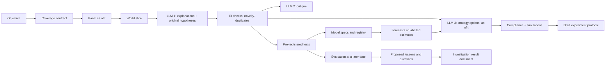

# R2: First complete intelligence operating loop (implemented, offline)

Status: **implemented and tested offline with mock agents** (2026-11-23). No paid API calls were made;
the spend ledger is unchanged (24 entries, $0.020759). No interventions were executed and no lessons
were promoted.

Related documents:
- [INVESTIGATION_RESULT_CONTRACT.md](INVESTIGATION_RESULT_CONTRACT.md) (output schema, statuses, API);
- [CAPABILITY_MATRIX.md](CAPABILITY_MATRIX.md) (status per capability);
- [ARCHITECTURE_DECISIONS.md](ARCHITECTURE_DECISIONS.md) (ADR-015 to ADR-018);
- [R1_IMPLEMENTATION.md](R1_IMPLEMENTATION.md) (the epistemic foundation R2 builds on).

## 1. The loop



| Layer | What R2 implements | Files |
|---|---|---|
| L1 | Task-class routing (`configs/llm/routing.toml`); one provider and spend guard per model; 3 calls per investigation | `src/halibut/agents/routing.py` |
| L2 | A generic `csv_panel` transactions provider (any industry; content-addressed; publication dates per row) alongside DfT | `src/halibut/world/panel.py`, `configs/data/provider_coverage.toml` |
| L3 | An industry-neutral **share panel** with 5 metric templates, matching the legacy DfT signals exactly (maximum difference 0.0 on all 42 shared metrics at 2025-05-23); context assembly v0 (budgeted slice, anomaly scan, reference library) | `src/halibut/world/panel.py`, `src/halibut/world/context.py` |
| L4 | An orchestrator with a template plan, adaptive skips and stopping rules; three roles (Hypothesis Generator + Investigator, Critic, Strategist) with strict schemas; deterministic mock responders | `src/halibut/investigation/loop.py`, `src/halibut/agents/loop_agents.py`, `src/halibut/agents/mock_loop.py` |
| L5 | A **model registry**: 5 forecasting families, 1 scenario family, 2 registered-but-unavailable families (causal DiD, synthetic ABM); validation rule `model-validation-v1`; official forecasts only from validated versions | `src/halibut/models/registry.py` |
| L6 | The implication compiler; pre-registered tests; resolution at an evaluation date; hypothesis statuses; forecast scoring; proposed lessons and questions | `src/halibut/investigation/compiler.py` |
| L7 | Option validation, a compliance checklist, scenario simulation per competitor response, a draft experiment protocol with power and MDE | `src/halibut/investigation/strategy.py` |
| L8 | An approvals record (requests plus append-only decisions) with authorization checks; `halibut approvals` and `halibut investigation` commands; a read-only result API | `src/halibut/control/approvals.py`, `src/halibut/command/api.py`, `src/halibut/investigation/cli.py` |
| EI | R1 ledger, schemas and events, extended to every new claim; result-document validation | `src/halibut/investigation/artifact.py` |

Migration 7 adds `approvals`, `approval_decisions`, `model_versions`, `hypothesis_tests`,
`test_results` and `investigations`, all append-only through triggers.

## 2. Separating outputs (founder requirements 1, 2 and 6)

- **Original hypotheses.** Mechanisms, conditions, assumptions, alternatives (each with the implication
  that discriminates between them), uncertainty and refutation criteria are free text. Only the
  *observable implications* use the measurement grammar, so they can be tested. An implication that
  needs data the evidence lacks uses template `other` and stays **untested**; it is recorded as a
  question naming the data required. Implication signatures are compared with a reference library
  (the deterministic workforce's templates plus earlier hypotheses for the market from *other*
  investigations). A hypothesis whose testable implications are all in the library is labelled
  `restatement`. Identical implication sets in one reply are dropped as duplicates and recorded.
- **Tests, not opinions.** Each implication becomes a test frozen at t: metric, comparator and
  reference value fixed at t, over the next two quarters. It resolves only with data published by the
  evaluation date; unpublished targets stay `pending`. Each test records whether simple momentum
  extrapolation already predicts it (`trend_consistent`). A hypothesis that survives only
  trend-consistent tests has **weak** support. **Survival is labelled "not causal proof".**
- **Forecasts versus estimates.**
  - Agents may request a model family and numerical assumptions.
  - The registry validates the spec (bounds, data length, availability).
  - It checks that execution is reproducible.
  - It backtests on data available at t against persistence (`model-validation-v1`).
  - Only validated versions issue `forecast` claims. Unvalidated versions issue labelled `estimate`
    claims. Rejected specs (e.g. a logistic on a share gap, a saturation below the observed maximum,
    causal DiD without unit-level data) produce no numbers.
  - Agents' numerical assumptions are recorded as `assumption` claims scoped to the model version.
- **Strategy at t.** The Strategist sees hypotheses, test *registrations* and baseline forecasts, never
  test outcomes, so options use only information available at t (tested in
  `tests/test_r2_loop.py`). Option effects are agent **assumptions**, simulated with
  `simulation.share_shift` against the best validated baseline. Simulated outcomes are conditional,
  uncalibrated and never scored.

## 3. Integrated UK run (real data, mock agents)

The command:

```
halibut investigation run configs/intel/markets/uk_cars_bev_v1.toml --as-of 2025-05-23 --evaluate-at 2026-11-23
```

It ran on a copy of the store. The evidence is 42 quarters (2014-Q3 to 2024-Q4); 2025-Q1 was not
published by 2025-05-23.

| Hypothesis (mock; not intelligence) | Novelty | Tests (2025-Q1 to Q2) | Status |
|---|---|---|---|
| H1 *Specialist momentum*: Tesla's segment position keeps improving because its range is concentrated in the growing segment; alternative: temporary price incentives | original | I1 segment share above 13.20% (against trend): **failed**, 10.11%. I2 Tesla–MG gap above 7.53% (trend-consistent): **failed**, 7.04% | refuted |
| H2 *Incumbent mix cushion*: MG loses inside the segment but its total share holds | original | I1 MG segment share below 5.67%: **passed**, 3.07%. I2 MG total share above 4.16%: **failed**, 4.00% | refuted |
| H3 *Local infrastructure* drives regional adoption differences | original | not testable: needs regional data | untested (question recorded) |
| H4 Tesla's total share keeps moving as it did | **restatement** | below 2.52% (trend-consistent): **passed**, 2.13% | survived, **weak**; not causal proof |
| H5 duplicate of H1 | — | — | dropped, recorded |

**Models.** 14 versions: 6 validated, 7 unvalidated, 1 rejected. Official forecasts, scored on
publication:
- `baseline.level` for Tesla's segment share: 13.20% (80% 10.75–15.64%). It missed the 10.11%
  outcome by 3.09 pp.
- `baseline.momentum`: 11.25% (8.80–13.70%). It covered the outcome, missing by 1.14 pp.

The logistic diffusion model for Tesla's segment share failed validation (MAE above 1.25 × persistence).
Its output (21.31%) is kept only as a labelled estimate.

**Strategy.** Three competing options for the focal brand BYD:
- distribution and availability;
- price and financing;
- service and quality.

Each has competitor responses, a cost (unknown, or a placeholder explicitly marked *not sourced*),
risks, measurable success criteria and a compliance checklist. The checklist flags exclusionary-conduct
review for the displacement objective and a pricing review for the price lever. Six simulations were
run: one with no response and one per competitor response. For example, O1 with no response gives
2.09–3.95% against a 2.52% baseline; with a Volkswagen distribution response it gives 1.94–3.75%. The
draft protocol (staggered regional rollout, difference-in-differences) is **not adequately powered on
national data**: the minimum detectable effect is 0.54 pp against an assumed effect of 0.05 pp after
responses. It records that regional outcome data are required, and its approval request is open
(`requested`), grantable only by a named person with a legal review reference.

**Cost and coordination.** 3 calls, $0; an identical rerun produces the same `content_hash` with 3
cache hits.

## 4. Cross-industry run

The command:

```
halibut investigation run tests/fixtures/market_plant_milk_panel.toml --as-of 2024-06-30 --evaluate-at 2025-06-30
```

It uses a fictional GB plant-based-milk panel (`csv_panel`, segment "barista"). Its last quarter is
2024-Q1, because Q2 was published after the as-of date. The run gives:
- 3 original hypotheses and 1 restatement;
- H1 survived, H2 refuted, H3 untested;
- 12 validated forecasts (of 14 model versions: 12 validated, 1 unvalidated, 1 rejected), 3 options and a draft protocol.

No vehicle-specific code runs. A market with no transaction provider (`tests/fixtures/market_non_vehicle.toml`)
returns `insufficient_evidence`, with no agent calls and no fabricated results.

## 5. Tests

`tests/test_r2_loop.py` (12 cases) and `tests/test_r2_registry_approvals.py` (6) cover:
- the full UK loop and its link chain;
- temporal integrity, and the strategist seeing no outcomes;
- survival labelling and reproducibility (identical content hash, no new claims on rerun);
- the non-vehicle market, and a market without evidence;
- an unusable generator reply stopping the run (truncated, top-level schema violation, missing key);
- fabricated evidence and invalid options rejected without repair;
- paid runs needing a granted, capped, matching approval;
- the published schema and the read-only API;
- the registry: validation, rejection, reproducibility, no future data in backtests, pooled baselines
  matching tests;
- approval rules: agents can't request paid runs or actions; no self-approval; legal review and
  outcomes needed for experiments; revocation; append-only;
- routing.

All 277 tests pass: 259 earlier and 18 new.

## 6. Limitations (honest list)

1. **Mock agents are not intelligence.** All examples above come from deterministic mock responders.
   Whether Claude produces hypotheses that are original *and* survive informative tests is
   unmeasured; that is the purpose of the first live R2 run.
2. **One evaluation window per investigation.** Tests cover two quarters; one investigation gives a
   handful of tests, so statistical power comes only from many origins and markets (R3).
3. **The measurement grammar is narrow.** Five share templates, two-quarter horizons, quarterly panels
   only. Prices, margins, surveys and regional data are missing, so mechanisms needing them stay
   untested. That is honest, but limiting.
4. **The model registry is univariate.** No covariates, no hierarchical pooling, no causal
   identification (DiD is registered as unavailable). The validation rule is simple and its
   thresholds (coverage ≥ 0.5, MAE ≤ 1.25 × persistence) are judgement calls.
5. **Strategy effects are assumptions.** `simulation.share_shift` adds an assumed effect and assumed
   competitor offsets to a forecast; nothing is calibrated, and costs are unknown unless supplied
   with a basis.
6. **Latest-vintage data.** Backtests and tests use the latest published values (no historical
   vintages, R4), and DfT history uses estimated publication dates.
7. **LLM knowledge leakage.** A live model may know 2025 outcomes from training. Live evaluation
   should prefer the most recent origins and label pre-cutoff results.
8. **Reviewer-facing gaps.** There is no HTTP layer or dashboard (deferred). Tenancy is only on
   claims and validation records. The compliance checklist is generic, not jurisdiction-specific law.
