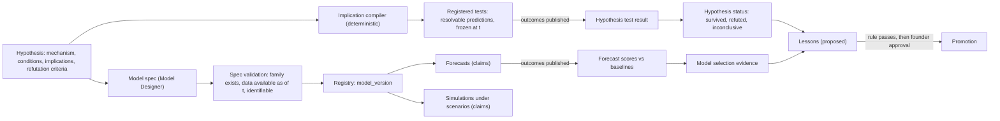

# Simulation and Learning (Master Architecture v1.0, layers L5 and L6)

Related documents:
- [MASTER_ARCHITECTURE.md](MASTER_ARCHITECTURE.md#l5-modelling--simulation) (layer contracts; claim taxonomy in §4)
- [AGENT_SYSTEM.md](AGENT_SYSTEM.md#5-original-hypothesis-discovery) (where hypotheses come from)
- [STRATEGIC_OPERATING_LOOP.md](STRATEGIC_OPERATING_LOOP.md) (where simulations are used)
- [CAPABILITY_MATRIX.md](CAPABILITY_MATRIX.md#l5-modelling--simulation)

Status: **proposed design**. These parts exist today:
- the scorer (`learning/predictions.py`);
- replay (`intel/replay.py`);
- the evaluation rule (`learning/evaluate.py`);
- the ABM (`engine.py` and related modules);
- the baselines (`empirical/baselines.py`);
- calibration (`calibration.py`, `empirical/fit.py`).

They are not yet joined by a model registry or a hypothesis-test lifecycle.

## 1. Four outputs, four lifecycles

| | Explanation | Hypothesis | Forecast | Simulated outcome |
|---|---|---|---|---|
| Question answered | Why did this happen? | What mechanism would explain it, and how could it be wrong? | What will the number be? | What would happen *if* the scenario held? |
| Time direction | Past | Past → future (implications) | Future | Conditional |
| Produced by | L4 agent | L4 agent | L5 registered model | L5 registered model + scenario |
| Gate before recording | Evidence fidelity | Structure, compilable implications, evidence validity, novelty | Model version, as-of inputs, interval, resolution rule | Scenario and assumptions attached, calibration status |
| Judged by | Fidelity audit; later superseded or confirmed by tested hypotheses | Implication tests: survival, refutation, information gain | Proper scoring rules against baselines | Only as a conditional forecast if its conditions occur; otherwise *never* scored |
| Can change behaviour? | No | Yes, by motivating model specs and options | Yes, through model selection (promotion) | Yes, through option comparison (with uncertainty) |

These four never substitute for each other.
- A report section that mixes them labels each sentence's type.
- A scoring job that receives a simulated outcome or an explanation rejects it.

## 2. From hypothesis to testable model



**Implication compiler.** It maps each `observable_implication` (AGENT_SYSTEM §4) onto the
semantic metrics catalogue and onto a resolution rule. The rule fixes:
- the target periods;
- which vintage counts as the outcome;
- the earliest resolution date (the publication calendar).

The compiler rejects implications that are not computable, already resolved at `t`
(hindsight), or identical to the reference library's signatures (restatements count as
duplicates).

**Model spec** (v1, abridged):

```json
{"family": "logistic_diffusion | bass | holt | hierarchical_share | structural_mnl | abm",
 "target": "metric template + scope",
 "covariates": ["metric ids or series, as-of available"],
 "structure": {"terms": ["e.g. charging_density x price_gap"], "constraints": ["sign: +"]},
 "priors": {"param": "distribution"},
 "derived_from_hypothesis": "hyp:…",
 "evaluation": {"protocol": "rolling-origin", "origins": "…", "baselines": ["level", "logistic"], "metric": "interval score"}}
```

A spec that cannot be estimated from data available at `t` (identifiability or data
coverage) is rejected with reasons before any computation is spent.

## 3. Model families and the registry

| Family | Current code | Typical use |
|---|---|---|
| Persistence, drift, Holt, linear | `empirical/baselines.py`, `intel/forecast.py` | Mandatory baselines |
| Logistic and Bass diffusion | `empirical/baselines.py` | Adoption and substitution |
| Share policies (level, momentum, last quarter) | `intel/forecast.py` | Competitive share forecasts |
| Agent-based consumer model | `engine.py` and related modules, `empirical/fit.py` | Mechanisms with networks, heterogeneity, interventions |
| Hierarchical share models (planned) | — | Many products × countries with partial pooling |
| Structural demand (planned) | `decision.py` (MNL, synthetic) | Price response, substitution |
| Competitor response (planned) | — | Strategic reactions: rule-based first, game-theoretic later |
| System dynamics and macro links (planned) | — | Economic forces, capacity, supply |

The registry records for each `model_version`:
- spec;
- code version and engine version;
- calibration result id;
- data vintage set;
- status;
- the promotion that activated it.

It generalises today's `promotions` + `memory.active(component)`.

## 4. Model selection

1. **Baselines are mandatory.** No model is used for decisions unless it beats the persistence
   and diffusion baselines on held-out origins. This lesson comes from Phase 3, where logistic
   and Bass beat the calibrated ABM.
2. **Proper scoring.** The interval score at 80% (already implemented), CRPS for distributions,
   and Brier for directions. MAE is reported, never used alone.
3. **Paired development and held-out units, split in advance.** This is the existing rule
   `paired-dev-holdout-v1`, extended to market × origin units.
4. **Complexity must pay for itself.** A more complex model wins only if its held-out
   improvement exceeds a pre-stated margin; the cost of running it enters the comparison
   (§9).
5. **Ensembles** (Growth) are registered models too, with fixed weights estimated on
   development units.

## 5. Calibration and uncertainty

- **Calibration methods:**
  - method of simulated moments and ABC (`calibration.py`; synthetic twin experiments today);
  - differential evolution plus Nelder–Mead (`empirical/fit.py`);
  - Bayesian calibration at Growth.

  Identifiability is checked first; twin experiments are required before calibrating a new
  structure on real data.
- **Uncertainty is reported by source:**
  - *parameter* (calibration posterior or bootstrap);
  - *structural* (spread across admissible model families);
  - *scenario* (assumptions);
  - *measurement* (source flags, universe caveats such as DfT imports);
  - *simulation noise* (seeds; common random numbers already in place).

  Every forecast states its interval method (naive or empirical, as in `intel/forecast.py`).
- **Calibration of intervals is itself evaluated.** 80% intervals must cover about 80% on
  held-out data. The empirical interval policy (coverage 0.92 at MAE 0.55 pp in the
  2026-11-23 replay) is the current reference.

## 6. Competitor responses and counterfactuals

- **Competitor response** is a modelling component, not an agent's opinion. The rule
  library runs from MVP to Growth:
  - match price;
  - hold;
  - expand range;
  - increase distribution.

  Each rule carries assumptions. At Full scale come estimated reaction functions from history
  and game-theoretic equilibria for oligopolies. The Simulation Designer proposes response
  scenarios; L5 runs them; outcomes are **simulated outcome** claims.
- **Counterfactuals** use common random numbers (already implemented) so that the
  intervention effect is isolated from noise. Every counterfactual states its assumption set,
  and `suite.py` already separates intervention effects from assumption effects.

## 7. Backtesting and leakage control

- **Rolling-origin backtests** use as-of views (implemented: `empirical/backtest.py`,
  `intel/replay.py`).
- **Vintage-correct evaluation.** Inputs come from the latest vintage available at the origin,
  and outcomes come from the vintage specified in the resolution rule (normally the first
  release after the target period plus a fixed revision window). This requires
  vintage-preserving ingestion (R4).
- **Publication-date basis is reported.** Each evaluation reports the share of inputs and
  outcomes resting on `estimated_lag` dates.
- **LLM training-cutoff control.** Every LLM-originated claim records the model's
  documented training cutoff. Evaluations of LLM-originated hypotheses and model specs are
  split into pre-cutoff (labelled "potentially contaminated") and **post-cutoff** windows;
  promotion decisions use post-cutoff evidence. Where post-cutoff data is too thin, the
  result is "inconclusive", not "validated".
- **Pre-registration.** Tests and model specs are frozen in the ledger before their outcome
  windows are published, with a hash of the spec. Replays verify the freeze date.

## 8. Outcome evaluation and hypothesis status

| Hypothesis status | Rule (v1) |
|---|---|
| `proposed` | Accepted by EI; implications registered |
| `survived` | All decisive implications resolved, none refuted, at least one with a non-trivial prior chance of failing (the test could have failed) |
| `refuted` | A pre-registered refutation criterion was met |
| `inconclusive` | Mixed results, outcomes not yet published, or only pre-cutoff evidence |
| `superseded` | A more general hypothesis survived the same tests plus more |

**Information gain** is the reduction in forecast loss when the hypothesis's model spec
replaces the baseline on held-out units. It is the bridge between "interesting" and "useful".

**Hypothesis metrics per workforce:**
- original (non-duplicate) hypotheses per investigation;
- share with compilable implications;
- survival rate;
- refutation rate (a healthy system refutes things);
- information gain;
- critic skill (critiques anticipating refutations).

## 9. Cost per useful validated result

**Definition (v1).** A *useful validated result* is either:
1. a hypothesis with status `survived` whose implications were **not** in the reference
   library; or
2. a model version whose held-out proper score beats the active baseline under the evaluation
   rule.

`cost per useful validated result = (LLM spend + paid data + compute cost attributed to the
workforce) / count(useful validated results)`.

Counting rules, from benchmark finding F1:
- a result the reference workforce also produced counts as **zero marginal value**;
- duplicates count once;
- a refuted hypothesis is not a useful validated result, but is reported as learning.

Both quality and cost are always reported. A cheaper workforce wins only at equal or better
quality per the rule; a better workforce must state its marginal cost.

## 10. Learning and validation

- **Lessons** are proposed generalisations, linked to the evaluations that motivate them.
  They are **never** treated as demonstrated improvements. A lesson becomes `validated` only
  through an evaluation that passes the versioned rule
  (`learning/memory.py` enforces this today).
- **Promotion** changes a registry version (model, prompt, routing table, agent
  configuration). It needs an eligible evaluation **and** founder approval, and it is
  reversible (`rollback`). L6 only *proposes*.
- **Agent evaluation** happens on fixed evidence snapshots (hash-checked, as in today's
  benchmark):
  - matched comparisons (the same predictions or implications);
  - selection-vs-random tests;
  - power analysis before paid runs, so benchmarks that cannot answer the question are not
    run.
- **Error analysis** clusters failures by type: format, schema, unsupported kind, fabricated
  evidence, number mismatch, leakage, truncation, refusal. Recurring clusters become
  engineering tasks, not lessons.

## 11. Maturity

| | MVP | Growth | Full |
|---|---|---|---|
| L5 | Registry over existing families; forecasts and simulated outcomes as typed claims; implication compiler; spec validation | Hierarchical and structural models; competitor-response rules; ensembles; Bayesian calibration | Coupled multiscale models across markets; scenario trees at scale |
| L6 | Hypothesis tests and statuses; matched and selection-aware benchmarks; failure taxonomy; duplicate removal; cutoff tagging; cost per useful validated result v1 | Multi-market evaluation; vintage-correct outcomes; prompt and agent A/B; critic skill | Continuous evaluation of live predictions; automatic proposal of routing and model promotions (approval still required) |
