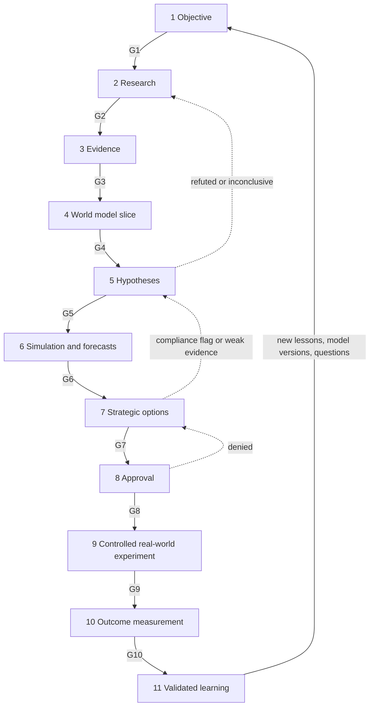

# Strategic Operating Loop (Master Architecture v1.0, layers L7 and L8)

Related documents:
- [MASTER_ARCHITECTURE.md](MASTER_ARCHITECTURE.md#l7-strategic-intelligence)
- [AGENT_SYSTEM.md](AGENT_SYSTEM.md)
- [SIMULATION_AND_LEARNING.md](SIMULATION_AND_LEARNING.md)
- [ADR-007](ARCHITECTURE_DECISIONS.md#adr-007) (lawful strategy policy)

Status: **proposed design**. Today only the objective-like market spec (`intel/market.py`),
research, evidence, the world model core, hypotheses (template-bound), replay scoring and
lessons exist. Strategic options, approvals as records, experiments and outcome measurement
are missing ([CAPABILITY_MATRIX.md](CAPABILITY_MATRIX.md#l7-strategic-intelligence)).

## 1. The loop

## 2. Stages, outputs and quality gates

| # | Stage | Owner | Measurable output | Gate to next stage (all must pass) |
|---|---|---|---|---|
| 1 | **Objective** | Founder or client via L8 | Objective record: market definition, mode (enforcement, continuation or annihilation), decision to be informed, horizon, budget, jurisdictions, success metric | **G1:** market definition resolves to a universe and denominator; budget allocated; mode-specific lawful constraints attached; decision named |
| 2 | **Research** | L4 Investigator + L2 | Research plan; sources used and proposed; fetch costs | **G2:** every source is catalogued with licence; spend within budget; new or paid sources approved |
| 3 | **Evidence** | L2 → L3 | Snapshots, observations and assertions with availability bases; quality report | **G3:** quality checks pass or failures are recorded; the share of evidence on estimated dates is reported; contradictions are listed |
| 4 | **World model slice** | L3 | Slice: entities, metrics and hierarchy level; coverage statistics | **G4:** coverage meets the objective (competitor set, periods, geographies); gaps listed as questions |
| 5 | **Hypotheses** | L4 Generator + Critic; EI | Original hypotheses with compiled implications; critiques; explanations kept separate | **G5:** schema-valid; evidence-faithful; ≥1 discriminating implication; novelty vs reference library; critic severity recorded |
| 6 | **Simulation and forecasts** | L5 | Forecast claims from registered models; simulated-outcome claims per scenario with assumptions and uncertainty | **G6:** models beat baselines on held-out units, or are labelled "unvalidated"; scenarios state assumptions; competitor responses included where relevant |
| 7 | **Strategic options** | L7 Strategy (agent + templates) | Options: lever set, expected effect range (simulated), risks, competitor responses, cost, reversibility, compliance checklist | **G7:** **compliance gate**. Only registered lawful levers; jurisdiction checklist complete; no prohibited tactics; human legal review flagged for consequential options; evidence chain from option to tested hypotheses |
| 8 | **Approval** | Founder (L8 control plane) | Approval record: approver, scope, budget, guardrails, expiry | **G8:** explicit approval with named approver; budget and guardrails set; experiment protocol attached |
| 9 | **Controlled real-world experiment** | Client or partner executes; L7 monitors | Executed protocol log; guardrail metrics | **G9:** pre-registration frozen before start; guardrails monitored; stop rules honoured; no deviation without re-approval |
| 10 | **Outcome measurement** | L2 (measurement ingest) + L6 | Outcome observations with provenance; effect estimate with uncertainty | **G10:** measurement matches the pre-registered metric and window; attribution method as registered; data quality checks pass |
| 11 | **Validated learning** | L6; founder for promotions | Hypothesis statuses, model evaluations, lessons (proposed), promotion proposals | Lessons stay `proposed` until the evaluation rule passes; promotions need approval |

## 3. Lawful strategy policy for the three modes

The strategic modes are **analytical objectives**. They describe *what* market outcome is
sought, never permission to pursue it by any means.

| Mode | Legitimate means (registered levers) | Excluded |
|---|---|---|
| Trend Enforcement | Product quality and range, price, distribution, availability, service, disclosed advertising, financing terms, supporting infrastructure | Fake reviews, astroturfing, undisclosed paid influence, bots, misinformation |
| Trend Continuation | Same levers; retention through quality and service | Lock-in through deception, hidden terms |
| Trend Annihilation | **Competing better**: superior offers, pricing above cost, wider availability, better service, truthful comparative advertising | Predatory pricing intent, collusion or information exchange with competitors, sabotage, smears, disparagement, exclusionary abuse of dominance, impersonation, unauthorised outreach |

The existing code enforces the lever whitelist (`validation.ALLOWED_LEVERS`) and catches
prohibited tactics (`validation.PROHIBITED`) as a backstop. The architecture adds:
- per-jurisdiction checklists (competition law, consumer protection, advertising standards,
  data protection, market-abuse rules for listed companies);
- a dominance flag: if the focal firm may be dominant in the market, exclusionary-conduct
  review becomes mandatory;
- **human legal review** for any option marked consequential. Halibut never presents an option
  as legally cleared.

## 4. Experiment protocol (object, v1)

| Field | Content |
|---|---|
| Hypothesis and option | Claim ids being tested |
| Design | Randomised (regions, stores, time blocks) or quasi-experimental (difference-in-differences, synthetic control), with justification |
| Units and assignment | Unit definition, randomisation seed, balance checks |
| Primary metric | Metric template + scope, from the semantic metrics catalogue |
| Minimum detectable effect and power | Computed before approval; experiments unlikely to detect the effect are not proposed |
| Guardrails | Metrics and thresholds that stop the experiment (e.g. margin, complaints, stock-outs) |
| Duration and stop rules | Fixed horizon, or sequential with pre-stated boundaries |
| Measurement | Data source, provenance, latency, access agreement |
| Ethics and compliance | Consent and data-protection basis, jurisdiction checklist, reviewer |
| Operator | Who executes (client team or partner); Halibut never executes |
| Pre-registration hash | Frozen before start |

## 5. Loop metrics (reported per objective)

- time and cost per stage;
- the stage at which each investigation stopped, and why;
- gate failure reasons;
- original hypotheses → survived → informed an option → tested in an experiment (funnel);
- experiment effect estimates against simulated expectations, which is the calibration of the
  simulation layer against reality;
- cost per useful validated result
  ([SIMULATION_AND_LEARNING.md §9](SIMULATION_AND_LEARNING.md#9-cost-per-useful-validated-result)).

## 6. Maturity

| | MVP | Growth | Full |
|---|---|---|---|
| Stages 1–6 | One market, offline replay, approved small LLM budget | Several markets and geographies; live evidence refresh | Industry and portfolio scale |
| Stage 7 | Deterministic option templates from tested hypotheses + simulation; compliance checklist | Strategy Analyst agent; competitor-response scenarios | Continuous strategy programmes |
| Stages 8–10 | Approval records; protocols drafted and **not executed** | First partner experiments; measurement connectors | Continuous approved experimentation |
| Stage 11 | Lessons and promotion proposals from replay | Plus experiment results | Portfolio learning curves |
