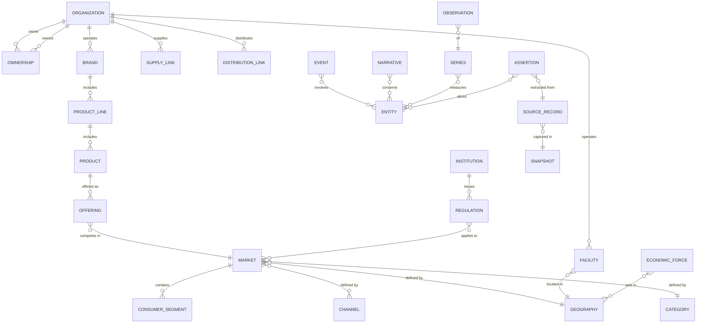
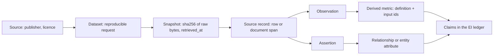

# World Model: canonical ontology (Master Architecture v1.0, layer L3)

Related documents:
- [MASTER_ARCHITECTURE.md](MASTER_ARCHITECTURE.md#l3-world-knowledge-base) (layer contract)
- [CAPABILITY_MATRIX.md](CAPABILITY_MATRIX.md#l3-world-knowledge-base) (what exists)
- [AGENT_SYSTEM.md](AGENT_SYSTEM.md#6-memory-and-context) (how agents read it)
- [ADR-003](ARCHITECTURE_DECISIONS.md#adr-003) (relational backbone)

Status: **proposed design**. The current schema (`src/halibut/data/store.py`, migrations 1–5)
implements the bitemporal observation core and a thin entity graph. §10 maps current tables to
this design.

## 1. Design principles

1. **Four co-equal stores in one model:**
   - an entity and relationship graph;
   - bitemporal observations;
   - documents and extracted assertions;
   - a semantic metrics catalogue.

   A graph alone cannot hold vintaged numeric series or recomputable metrics.
2. **Everything is dated twice**, in **valid time** (when it was true in the world) and
   **knowledge time** (when Halibut could have known it). The world model can therefore be
   queried *as it was knowable* on any date (principle G).
3. **Nothing is overwritten.** Revisions, merges, splits and corrections create new versions
   or assertions; old ones stay queryable.
4. **Facts and claims are separate.** Observations come from sources. Assertions are
   statements *about* the world from a source, an analyst or an agent, each with its own
   epistemic status and confidence. Contradictions are first-class.
5. **Hierarchies make scale tractable.** Product, geography and organisation trees with
   validity periods let questions be answered at the right level of aggregation.
6. **Tenancy from v1.** Every private item has a tenant; public knowledge is shared
   ([ADR-013](ARCHITECTURE_DECISIONS.md#adr-013)).

## 2. Core ontology

### 2.1 Entity kinds

| Kind | Definition | Key attributes | Example identifiers |
|---|---|---|---|
| `organization` | A legal or economic actor: company, subsidiary, group, cooperative, state enterprise | legal name, jurisdiction, status, listing | LEI, Wikidata QID, company register number, ticker |
| `brand` | A market-facing identity under which offerings are sold | name, aliases, operator(s) | QID, dataset make code (e.g. DfT `BYD`) |
| `product_line` / `product` / `offering` | Hierarchy from family to SKU; an *offering* is a product in a market and channel with a price and availability | attributes (typed per category), launch and withdrawal | GTIN, model code, internal SKU |
| `category` | A substitution space (what consumers trade off) | parent category, attribute schema | Internal taxonomy, NACE/NAICS/HS mapping |
| `market` | Category × geography × channel × customer type × period definition | universe definition, denominator, competitor set | Internal id (from the market spec) |
| `consumer_segment` | A population subgroup with distinct behaviour | definition (observable criteria), size estimate | Internal |
| `geography` | Site → locality → region → country → bloc (multiple hierarchies: administrative, statistical, commercial) | polygon reference, codes | ISO 3166, NUTS, FIPS (GDELT), OSM relation |
| `facility` | Store, dealer, plant, warehouse, charging site | location, operator, capacity | OSM id, internal |
| `channel` | Route to market: dealer, online, retail, fleet, wholesale | — | Internal |
| `institution` | Regulator, government body, standards body, central bank | jurisdiction, mandate | QID |
| `regulation` | A rule with legal effect | jurisdiction, effective dates, affected markets | Official reference (e.g. a CELEX number) |
| `event` | A dated occurrence: launch, price change, policy, shock, merger | announced, effective, available dates | Internal; existing `events` table |
| `narrative` | A recurring cultural or media framing (e.g. "EV range anxiety") | description, indicators | Internal |
| `economic_force` | Macro driver: income, interest rate, fuel price, FX | linked series | World Bank indicator code |
| `person` | **Only public roles** (CEO, minister) when necessary for organisation facts | role, organisation, validity | QID. No private individuals |

### 2.2 Relationship types (all with valid time, knowledge time, provenance and confidence)

| Predicate | Subject → object | Attributes |
|---|---|---|
| `owns` | organization → organization | stake %, voting %, control (bool), consolidation basis |
| `operates_brand` | organization → brand | role (owner, licensee, distributor) |
| `includes` | brand → line → product | — |
| `offered_in` | product → market (as offering) | price, availability, channel |
| `competes_with` | offering ↔ offering | substitution strength (estimate), evidence |
| `supplies` / `distributes_for` | organization → organization | goods, share of supply, contract dates |
| `located_in` | facility → geography | — |
| `part_of` | geography → geography; category → category | hierarchy id |
| `regulates` / `applies_to` | institution → regulation → market | — |
| `affects` | event / regulation / economic_force → market or entity | direction, mechanism (a hypothesis reference) |
| `concerns` | narrative → entity / market | salience series |
| `member_of` | consumer_segment → market | share estimate |

## 3. Identity

- **Canonical id.** `kind:namespace:local`, for example `org:wd:Q1234`, `brand:halibut:byd`,
  or `geo:iso:GB`. It is stable and never reused. The existing `stable_id`
  (`data/providers/base.py`) and Wikidata resolution are the seed.
- **Identifier crosswalk.** `entity_identifiers(entity_id, scheme, value, valid_from,
  valid_to, source)` maps many external ids to one canonical id. That table exists today
  without validity dates.
- **Resolution** is deterministic and audited, in this order:
  1. explicit analyst override (recorded as an assertion);
  2. strong identifiers (LEI, GTIN, QID);
  3. ranked candidate matching (types, names, locations);
  4. no match below threshold, leaving the item **unresolved**, never guessed.

  This generalises `data/providers/wikidata.py`.
- **Merges and splits** are events. A merge links the old ids to the new one with
  `supersedes`; nothing is deleted. Queries as of an earlier date see the entity structure of
  that date. A company acquired in 2023 belongs to its acquirer only from the acquisition's
  valid date.

## 4. Time

| Axis | Meaning | Column pattern |
|---|---|---|
| Valid time | When the fact was true in the world | `valid_from`, `valid_to`; observations use `period_start`, `period_end` |
| Knowledge time | When the fact became knowable (published, or estimated with basis) | `available_at`, `availability_basis` ∈ {published, estimated_lag, calendar, retrieval} |
| Vintage | Which release of a revised dataset | `revision` (and the snapshot id) |
| System time | When Halibut stored it | `created_at` (audit only; never used for as-of) |

**As-of query semantics.** For an origin `t`:
- return, for each key, the **latest vintage with `available_at ≤ t`**;
- relationships are filtered both by valid time (relevant to the question) and by knowledge
  time (`available_at ≤ t`);
- claims are visible only if their own knowledge time is `≤ t`, and their status is the status
  as of `t` (already implemented through `knowledge_status_history`).

**Availability basis must be honest.** `estimated_lag` (for example quarter end + 121 days for
DfT history) is allowed but labelled, and evaluations report what fraction of evidence rests on
estimates (`docs/benchmark_haiku_v1_diagnostic.md`, F7). The **Growth** target is
`calendar`: publication dates from the publisher's release calendar.

## 5. Uncertainty

- **Observations** carry the source's status flags (provisional, revised, suppressed) and, when
  published, standard errors.
- **Estimates** carry a distribution summary (point, sd or interval, method).
- **Assertions and relationships** carry `confidence` ∈ [0, 1]. It is the extractor's
  calibrated probability that the assertion is true as stated. LLM-extracted assertions start
  as `proposed`, with confidence calibrated against a human-labelled sample before use in
  scoring.
- **Epistemic status** ∈ {observed, derived, estimated, asserted, hypothesised, simulated}. It
  aligns with the claim types in
  [MASTER_ARCHITECTURE.md §4](MASTER_ARCHITECTURE.md#4-the-claim-taxonomy-principles-a-and-c).
- **Unresolved and unknown are values, not absences.** "Owner unknown" is a recorded state.

## 6. Provenance

- Every observation and assertion records its snapshot, source record locator (row key or
  document offset span) and extractor version.
- Derived metrics are **recomputable** from their definitions and input ids. The existing
  `intel/signals.py` and `validation.py` enforce this; it is the model for all derived values.
- Licences travel with data. An export or client report checks licence terms (attribution,
  share-alike) for every source it includes.

## 7. Contradictions and reconciliation

When sources disagree (two ownership stakes, two registration counts, a rumour against a
filing), the system works as follows:
1. **Keep both** as assertions with their own provenance, confidence and knowledge time.
2. **Detect** contradictions by rule: the same subject, predicate and valid time with
   incompatible values. Emit `assertion.contradiction.detected`.
3. **Resolve per question, not globally.** A resolution policy per predicate ranks sources
   (for example, a statutory filing beats a press report beats an LLM extraction), prefers
   later vintages *as of the query date*, and records the chosen value **with the losing
   alternatives** attached.
4. **Escalate.** If the contradiction is material (it changes a conclusion), raise an
   investigation task or ask a human. Agents may argue; resolution is by evidence rank or
   test, never by vote.
5. **Never silently average** incompatible facts. Averages are allowed only for estimates
   with stated uncertainty.

## 8. Scale: a multinational with thousands of products

Take a hypothetical consumer-goods group: 300 legal entities, 40 brands, 6,000 SKUs, sold in
70 countries through 5 channel types.

- **Storage.**
  - Offerings: 6,000 SKUs × 70 countries × 5 channels is at most 2.1 M rows, sparse in
    practice.
  - Quarterly observations: tens of millions of rows. That fits partitioned Postgres
    (partition by country and period) at Growth.
  - The graph is small: thousands of organisations and tens of thousands of relationships.
- **Hierarchies, not flat lists.**
  - SKUs roll up into lines, brands and the group;
  - countries roll up into regions and blocs;
  - subsidiaries roll up into parents, weighted by consolidation basis.

  Metrics are defined once ("share of category units within universe U") and evaluated at any
  node, with explicit aggregation rules: additive counts sum, shares recompute from sums, and
  prices aggregate with stated weights.
- **Market definitions are explicit objects.** "Premium shampoo, Germany, grocery channel,
  2025" is a market entity with a universe and denominator. Cross-market comparison is safe
  only when universes are compatible (the existing `universe_dims` discipline).
- **Context slices.** The Context Assembly service answers a request such as
  `scope={group, brand=X, geography=EU, category=haircare}`, `as_of`, `level=country×brand`,
  `budget=6k tokens` with:
  - compact aggregate tables;
  - the top-k anomalies;
  - ids for drill-down;
  - relevant validated claims and lessons.

  Agents drill down by requesting narrower slices; they never receive the 6,000-SKU table.
- **Incremental computation.** Aggregates are materialised per (node, period, vintage) and
  invalidated when an input vintage changes.

## 9. Physical design (MVP → Full)

| Concern | MVP (SQLite, current) | Growth (Postgres) | Full scale |
|---|---|---|---|
| Entities and relationships | `entities`, `relationships` + new `assertions`, `hierarchy_edges` | Same; GIN indexes on attributes | Partitioned; optional graph index |
| Observations | `observations` (bitemporal, revisions) | Partition by dataset and period | Columnar store for analytics if needed |
| Documents | `documents` + new `document_spans` | Full-text search | Search service |
| Metrics | Code definitions (`intel/signals.py`) | `metrics` catalogue table (definition JSON, version) | Materialised aggregates |
| Tenancy | `tenant` column, default `public` | Row-level security | Separate schemas or databases for regulated clients |

## 10. Mapping from the current schema

| Current | Becomes | Change needed |
|---|---|---|
| `entities.kind` (9 kinds) | Entity kinds §2.1 | Add organization (rename from company), offering, consumer_segment, channel, facility (from location), institution, regulation, narrative, economic_force |
| `relationships` | Relationships §2.2 | Add `confidence`, `tenant`, attribute JSON for stakes; keep `valid_from`, `valid_to`, `available_at` |
| `entity_identifiers` | Crosswalk §3 | Add validity and source |
| `observations` | Unchanged core | Add vintage-preserving re-ingest; `availability_basis = calendar` |
| `documents`, `document_entities` | Documents and spans | Add spans and text under licence |
| `events` | Event entities | Link to entities; keep `announced_date`, `effective_date`, `available_at` |
| `intel/market.py` TOML | `market` entity | Persist the market definition and universe |
| `hypotheses`, `knowledge`, `prediction_scores` | EI claim ledger (not L3) | See [SIMULATION_AND_LEARNING.md](SIMULATION_AND_LEARNING.md) |
| (none) | `assertions`, `hierarchy_edges`, `metrics`, `tenant` | New |
